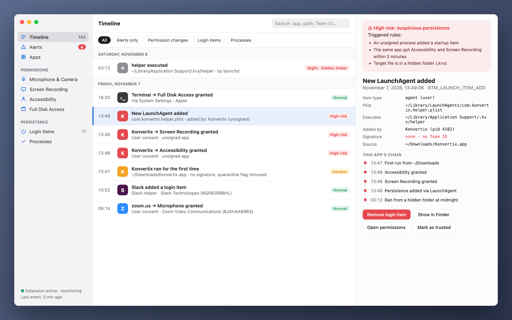
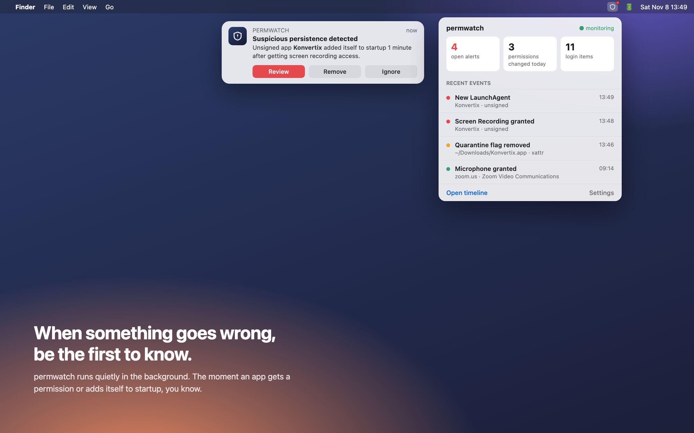
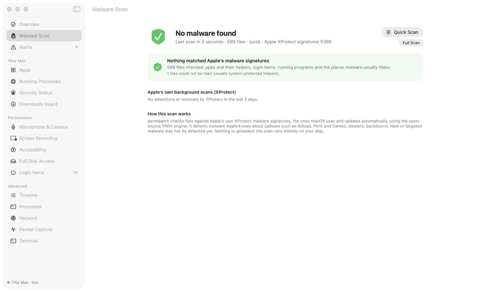
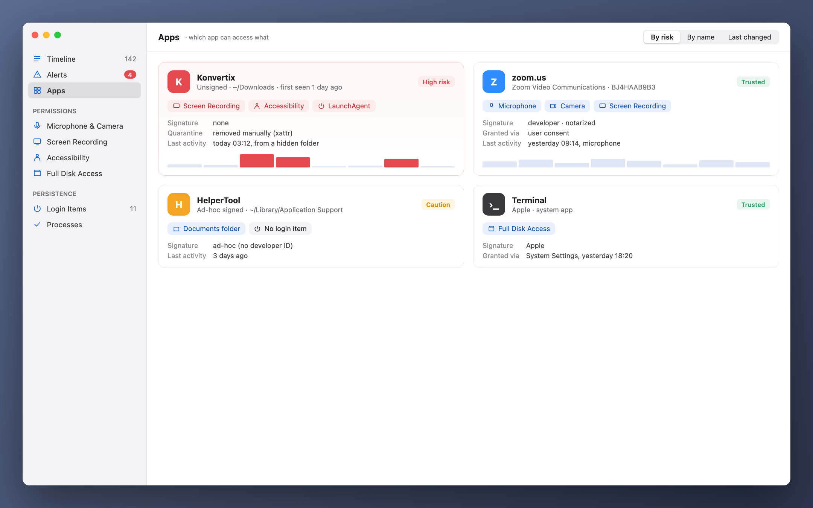

[Türkçe](docs/i18n/README_tr.md) · **English** · [Русский](docs/i18n/README_ru.md) · [Deutsch](docs/i18n/README_de.md) · [Français](docs/i18n/README_fr.md) · [Español](docs/i18n/README_es.md) · [Português](docs/i18n/README_pt.md) · [Italiano](docs/i18n/README_it.md) · [Українська](docs/i18n/README_uk.md) · [日本語](docs/i18n/README_ja.md) · [简体中文](docs/i18n/README_zh.md) · [한국어](docs/i18n/README_ko.md) · [العربية](docs/i18n/README_ar.md)

# permwatch

**See what every app on your Mac can access.**

Camera, microphone, screen recording, login items. 
permwatch keeps a record of every permission change and alerts you the moment something looks off.

 
---

## You clicked "Allow" and forgot

"Allow screen recording." "Accessibility access required." "Open at login?"

We click "OK" dozens of times a day. But which app did you give which permission, and when?
Which one quietly added itself to startup? macOS doesn't show you the answers.

**permwatch does.**

  

## A scenario

You download a free PDF converter. You open it, it asks for a few permissions, you click "OK".
Everything looks normal.

Meanwhile, permwatch sees this in the background:

| Time | What happened |
|---|---|
| 13:46 | The downloaded app's **quarantine flag was removed**, bypassing Gatekeeper |
| 13:47 | An **unsigned** app ran from Downloads for the first time |
| 13:48 | Within a minute it got both **Accessibility** and **Screen Recording** access |
| 13:49 | It **added a program from a hidden folder to startup** |
| 03:12 | At midnight, while you were asleep, **that hidden program ran** |

Each step looks harmless on its own. Put together, they form a familiar attack chain.
permwatch connects the dots and gives you one clear alert.

  

## What it does

- 🐞 **Malware scan:** Checks your apps, login items, running programs and downloads against **Apple’s own XProtect malware signatures** (the ones macOS keeps up to date), using the open-source YARA engine. A quick scan takes about 10 seconds. New downloads are scanned automatically, and anything found can be moved to the Trash together with the login items that start it.
- 🛡 **Overview and one-click check:** Opens with a clear verdict. "Check My Mac" runs the malware scan and checks for browser hijacking (extensions that can read every site, forced browser policies, changed search engine or start page), traffic interception (trusted root certificates, configuration profiles, proxies, unknown DNS, VPN configurations), remote access (Screen Sharing, SSH, TeamViewer/AnyDesk/ToDesk-style tools), VPN and DNS leaks, Safari extensions and spyware-like permission combinations. Every finding has a fix button.
- 💡 **Recommendations:** One screen that explains every finding in plain language and offers a one-click fix. It finds permissions left behind by deleted apps and permissions in apps you haven't opened for months.
- 🕒 **Timeline:** Every permission change and every new startup item, with its date and the process responsible
- 🚨 **Alerts:** Unsigned startup programs, suspicious permission patterns, Gatekeeper bypasses, and a small pop-up at the top of the screen when something new appears
- 🔍 **Apps:** All the permissions an app holds, on a single card. Revoke a permission or move the app to the Trash.
- 🧠 **Running apps:** A task manager that flags programs running from odd places, pretending to be system processes, or whose file was deleted
- 🌐 **Network:** Which app is connected where, with warnings for unsigned programs
- 📦 **Packet capture:** Like Wireshark, but every packet shows the app that sent it and a plain-language explanation. It spots trackers, unencrypted connections and passwords sent in clear text. Captures are saved as .pcap files you can open in Wireshark. Any server can be blocked with one click using the built-in macOS firewall.
- ⬇️ **Downloads:** Checks downloaded apps and installers anywhere on your Mac, including USB disks, with Gatekeeper
- 🎙 **Microphone and camera:** Who is using them right now, and a history
- ⌨️ **Terminal:** A real terminal inside the app (tabs, colours, full-screen programs) with a menu of ready-made security commands

  

  

## What it is not

permwatch is **not a full antivirus.** It detects the malware Apple's signatures know about, but it has no signatures of its own and **it doesn't block anything in real time.** It shows you what is happening, explains it and helps you fix it. If you want to block connections, use a firewall such as LuLu or Little Snitch alongside it.

The rules are heuristics: they can raise false alarms (for example with developer tools) and can miss well-hidden malware.

## Your privacy stays with you

permwatch **sends no data anywhere.** No analytics, no account, no cloud. Details: **[PRIVACY.md](PRIVACY.md)**

## How it works

- Reads macOS's permission database and startup items (with Full Disk Access) and watches them for changes
- Optional **administrator mode** installs a small helper as a system service (SMAppService) after a one-time approval in System Settings; macOS verifies its signature. It only works while permwatch is open and takes no commands; the only input it reads is a list of IP addresses to block, which it validates.
- Packet capture uses libpcap. With administrator mode it uses Apple's PKTAP, which attaches the sending process to each packet.
- An Endpoint Security engine (C) for real-time events is ready and waiting for Apple's entitlement.

## Third-party code

- [YARA](https://github.com/VirusTotal/yara) v4.5.8 by VirusTotal (BSD-3-Clause), used to run Apple’s XProtect signatures. Vendored in `app/vendor/yara`.
- [SwiftTerm](https://github.com/migueldeicaza/SwiftTerm) v1.20.0 by Miguel de Icaza (MIT), used for the terminal. Vendored in `app/vendor/SwiftTerm`.

## Status

- ✅ macOS app: permissions, startup items, processes, network, packet capture, downloads, recommendations. Available in 13 languages.
- ⏳ Apple Endpoint Security entitlement: requested, under review
- ✅ Notarized by Apple

Developer and want to try the core? **[Developer guide →](docs/GELISTIRME_en.md)**

## ☕ Buy me a coffee?

permwatch is free and open source, with no ads, accounts or tracking. If it helped you, a small donation keeps it going. Please send each coin only on the network shown.

| Coin | Address |
|---|---|
| Bitcoin (BTC) · Taproot | `bc1pyuwdr40733dtzkeefj6xu3asnncwa0a67q2q6sw7fuut4zfhx8yqf2ta3l` |
| Bitcoin (BTC) · SegWit | `bc1qevw8l3pwfahysgmxy0vhv2srnk0dcyze7pggq8` |
| Monero (XMR) | `42tsRvBWbPujgVpQdNy6Ba6ovKNcPkxQBKWn1rYcENDpAPTuvQ2ejxCXcUc5KJQTdkHicn4agR7GnYroSUGQLzVhL93KmTt` |
| Ethereum (ERC-20): ETH, USDC, USDT, SHIB, LINK, UNI | `0xCD9ab39db50A830e157776a97bc9Ae21811e3177` |
| Litecoin (LTC) · SegWit | `ltc1qx40ryzy34vf5977aq5uk3rpqm7err5jvf7gcwl` |
| Litecoin (LTC) · Legacy | `LV6kxUc84QoHq7zGZBz1T38vwdcAXQPxR1` |
| Dogecoin (DOGE) | `DTtZ7oJELg9hs43o1g97qVM676H46XorAT` |
| Solana (SOL) | `5uwHKnCMFbFpob2ssypd69svUFCYZQePCwZcQfELckAD` |
| Xelis (XEL) | `xel:h2mt8pc2059rgq3x67xhndqfm8xukrn49zx2la7qmjqnwhgftc4qqasdzay` |
| Banano (BAN) | `ban_1teuphtrxw6rtr7ttr7iaxtaspm11wjqhjh6j84twcp6pcbiyb4cgzth9439` |

---

Made by someone curious about macOS security, for the curious.

