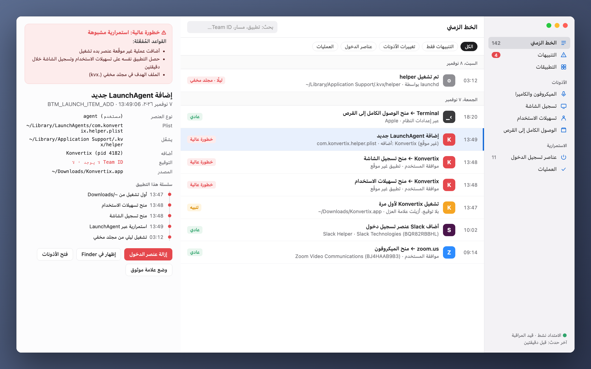
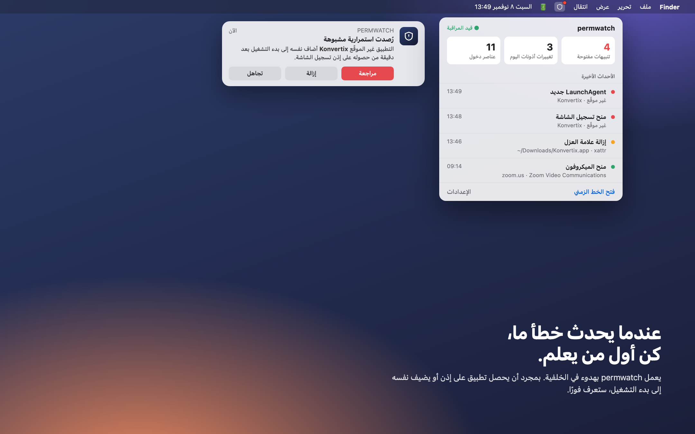
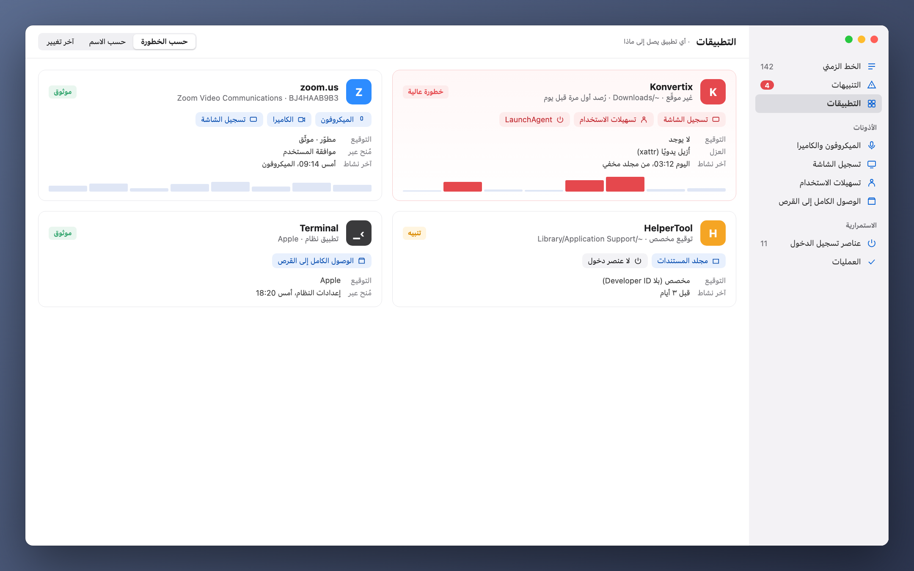

[Türkçe](README_tr.md) · [English](README.md) · [Русский](README_ru.md) · [Deutsch](README_de.md) · [Français](README_fr.md) · [Español](README_es.md) · [Português](README_pt.md) · [Italiano](README_it.md) · [Українська](README_uk.md) · [日本語](README_ja.md) · [简体中文](README_zh.md) · [한국어](README_ko.md) · **العربية**

# permwatch

**اعرف ما الذي يستطيع كل تطبيق على جهاز Mac الوصول إليه.**

الكاميرا، الميكروفون، تسجيل الشاشة، عناصر تسجيل الدخول. 
يسجّل permwatch كل تغيير في الأذونات وينبّهك فورًا عندما يبدو شيء ما مريبًا.

---

## سمحتَ ثم نسيت

«اسمح بتسجيل الشاشة.» «مطلوب الوصول إلى تسهيلات الاستخدام.» «هل تريد الفتح عند تسجيل الدخول؟»

نضغط «موافق» عشرات المرات يوميًا. لكن أي تطبيق منحته أي إذن، ومتى؟
وأيها أضاف نفسه بهدوء إلى بدء التشغيل؟ لا يُظهر لك macOS هذه الإجابات.

**أما permwatch فيُظهرها.**

  

## سيناريو

تنزّل محوّل PDF مجانيًا. تفتحه، فيطلب بعض الأذونات، فتضغط «موافق».
كل شيء يبدو طبيعيًا.

في هذه الأثناء، يرى permwatch في الخلفية ما يلي:

| الوقت | ما الذي حدث |
|---|---|
| 13:46 | **أُزيلت علامة العزل** عن التطبيق المنزَّل، أي جرى تجاوز Gatekeeper |
| 13:47 | تطبيق **غير موقّع** يعمل لأول مرة من مجلد التنزيلات |
| 13:48 | خلال دقيقة واحدة حصل على **تسهيلات الاستخدام** و**تسجيل الشاشة** معًا |
| 13:49 | **أضاف إلى بدء التشغيل برنامجًا من مجلد مخفي** |
| 03:12 | في منتصف الليل وأنت نائم، **عمل ذلك البرنامج المخفي** |

كل خطوة بمفردها تبدو بريئة. لكنها معًا تشكّل سلسلة هجوم معروفة.
يربط permwatch هذه النقاط ويعرض لك تنبيهًا واحدًا واضحًا.

  

## ماذا يفعل

- 🕒 **الخط الزمني:** كل تغيير في الأذونات وكل عنصر بدء تشغيل جديد، مع تاريخه والعملية المسؤولة عنه
- 🚨 **تنبيهات ذكية:** التطبيقات غير الموقّعة، والنشاط في منتصف الليل، ومحاولات تجاوز Gatekeeper
- 🔍 **عرض التطبيق:** جميع أذونات التطبيق في بطاقة واحدة
- 🧬 **فحص التوقيع:** هل هو Apple، أم مطوّر معروف، أم مصدر مجهول؟
- 📍 **في شريط القائمة:** لا يزعجك، لكنه يتكلم حين يلزم

  

## خصوصيتك تبقى معك

**لا يرسل permwatch أي بيانات إلى أي مكان.** لا تحليلات، ولا حسابات، ولا سحابة.
تبقى كل السجلات على جهاز Mac الخاص بك. وهذا أقل ما تنتظره من أداة للخصوصية.

## كيف يعمل

يستخدم permwatch إطار **Endpoint Security**، وهو الإطار الرسمي من Apple لبرامج الأمان.
النواة مكتوبة بلغة C. وهي **تراقب** فقط ولا تتدخل أبدًا في عمل النظام.

## الحالة

permwatch قيد التطوير النشط.

- ✅ محرك أساسي يلتقط الأحداث (سطر الأوامر)
- ⏳ إذن Endpoint Security من Apple: قُدِّم الطلب، وهو قيد المراجعة
- 🛠 تطبيق macOS والواجهة: في مرحلة التصميم

> الصور أعلاه معاينات للتصميم. تطبيق «Konvertix» في السيناريو تطبيق خيالي.

هل أنت مطوّر وتريد تجربة النواة؟ **[دليل المطوّر (بالإنجليزية) ←](docs/GELISTIRME_en.md)**

---

صُنع بيد شخص شغوف بأمان macOS، لكل الفضوليين.

