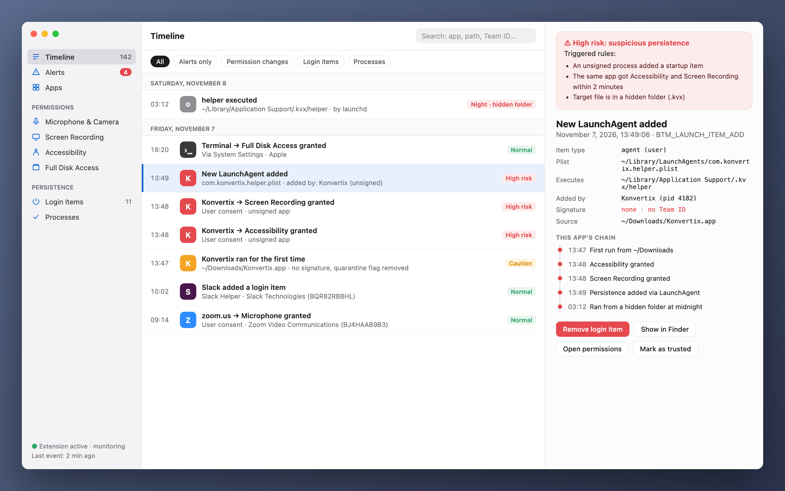
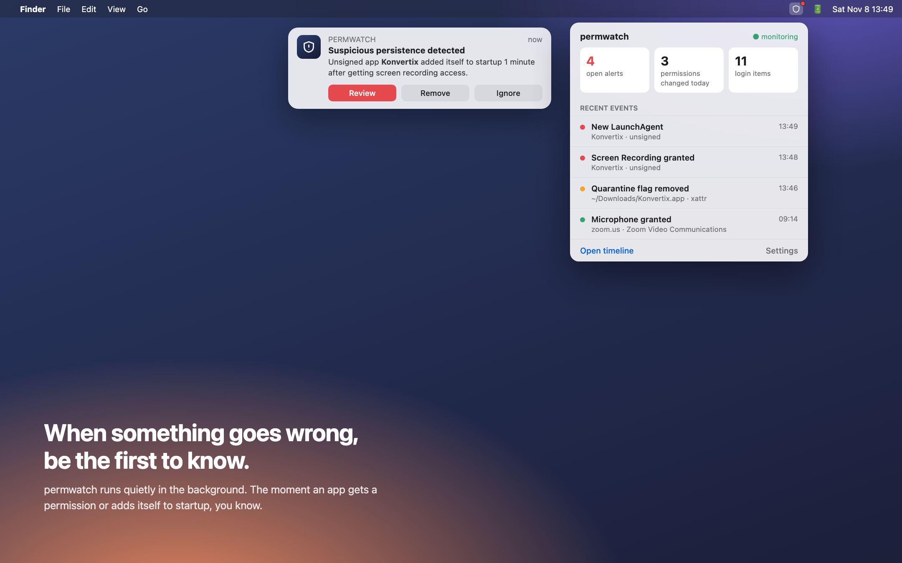
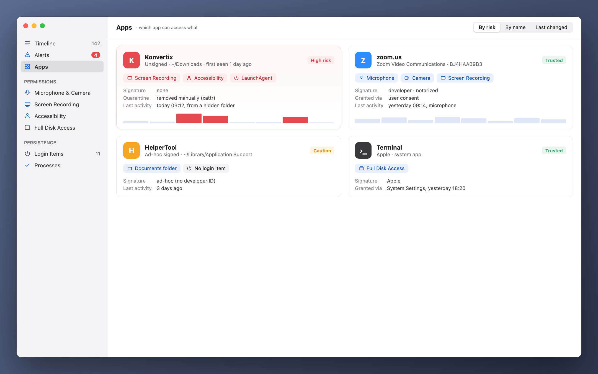

[Türkçe](README_tr.md) · **English** · [Русский](README_ru.md)

# permwatch

**See what every app on your Mac can access.**

Camera, microphone, screen recording, login items. 
permwatch keeps a record of every permission change and alerts you the moment something looks off.

---

## You clicked "Allow" and forgot

"Allow screen recording." "Accessibility access required." "Open at login?"

We click "OK" dozens of times a day. But which app did you give which permission, and when?
Which one quietly added itself to startup? macOS doesn't show you the answers.

**permwatch does.**

  

## A scenario

You download a free PDF converter. You open it, it asks for a few permissions, you click "OK".
Everything looks normal.

Meanwhile, permwatch sees this in the background:

| Time | What happened |
|---|---|
| 13:46 | The downloaded app's **quarantine flag was removed**, bypassing Gatekeeper |
| 13:47 | An **unsigned** app ran from Downloads for the first time |
| 13:48 | Within a minute it got both **Accessibility** and **Screen Recording** access |
| 13:49 | It **added a program from a hidden folder to startup** |
| 03:12 | At midnight, while you were asleep, **that hidden program ran** |

Each step looks harmless on its own. Put together, they form a familiar attack chain.
permwatch connects the dots and gives you one clear alert.

  

## What it does

- 🕒 **Timeline:** Every permission change and every new startup item, with its date and the process responsible
- 🚨 **Smart alerts:** Unsigned apps, midnight activity, Gatekeeper bypass attempts
- 🔍 **App view:** All the permissions an app holds, on a single card
- 🧬 **Signature check:** Apple, a known developer, or an unknown source?
- 📍 **In the menu bar:** Stays out of your way, speaks up when it matters

  

## Your privacy stays with you

permwatch **sends no data anywhere.** No analytics, no account, no cloud.
Every record stays on your Mac. You wouldn't expect anything less from a privacy tool.

## How it works

permwatch uses **Endpoint Security**, Apple's official framework for security software.
The core is written in C. It only **observes** and never interferes with how your system works.

## Status

permwatch is in active development.

- ✅ Core engine that captures events (command line)
- ⏳ Apple Endpoint Security entitlement: requested, under review
- 🛠 macOS app and interface: in design

> The images above are design previews. "Konvertix" in the scenario is a fictional app.

Developer and want to try the core? **[Developer guide →](docs/GELISTIRME_en.md)**

---

Made by someone curious about macOS security, for the curious.

