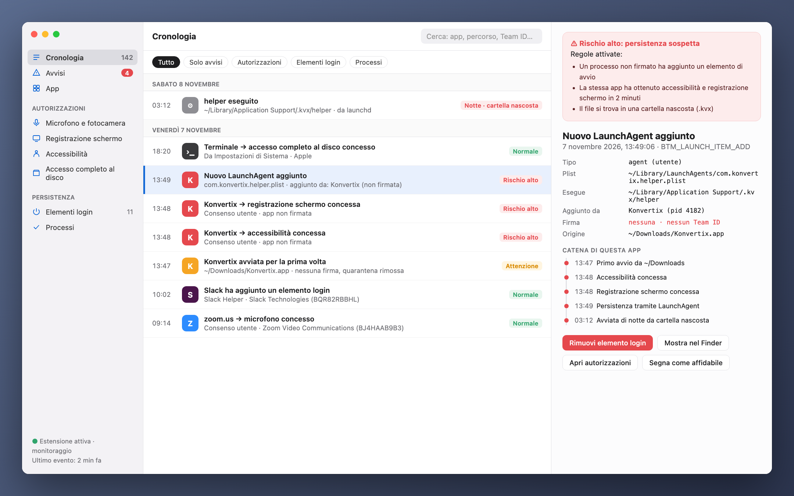
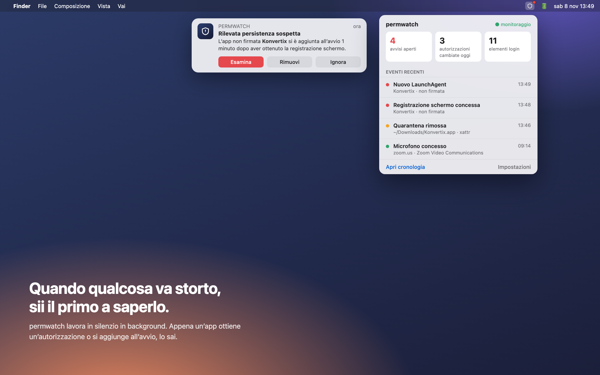
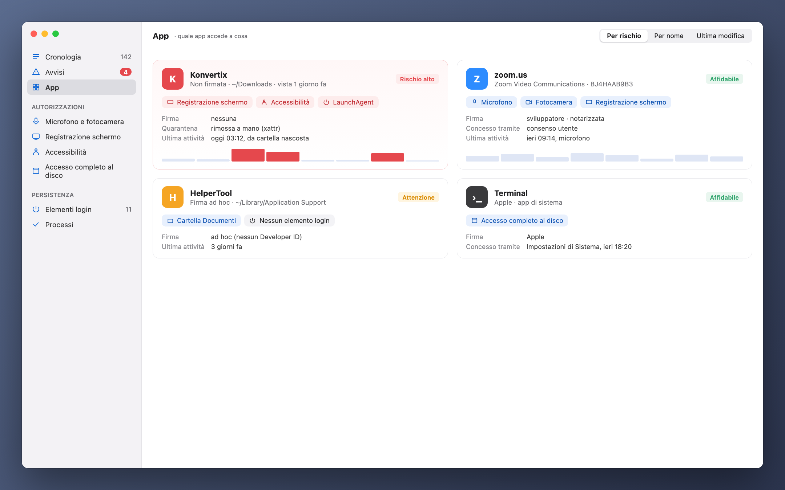

[Türkçe](README_tr.md) · [English](README.md) · [Русский](README_ru.md) · [Deutsch](README_de.md) · [Français](README_fr.md) · [Español](README_es.md) · [Português](README_pt.md) · **Italiano** · [Українська](README_uk.md) · [日本語](README_ja.md) · [简体中文](README_zh.md) · [한국어](README_ko.md) · [العربية](README_ar.md)

# permwatch

**Scopri a cosa può accedere ogni app del tuo Mac.**

Fotocamera, microfono, registrazione schermo, elementi di login. 
permwatch registra ogni modifica alle autorizzazioni e ti avvisa appena qualcosa non torna.

---

## Hai autorizzato e dimenticato

"Consenti la registrazione dello schermo." "È richiesto l'accesso ad Accessibilità." "Aprire al login?"

Clicchiamo "OK" decine di volte al giorno. Ma a quale app hai dato quale autorizzazione, e quando?
Quale si è aggiunta in silenzio all'avvio? macOS non ti mostra queste risposte.

**permwatch sì.**

  

## Uno scenario

Scarichi un convertitore PDF gratuito. Lo apri, chiede qualche autorizzazione, clicchi "OK".
Tutto sembra normale.

Nel frattempo, permwatch vede questo in background:

| Ora | Cosa è successo |
|---|---|
| 13:46 | Il **flag di quarantena** dell'app scaricata **è stato rimosso**, aggirando Gatekeeper |
| 13:47 | Un'app **non firmata** è stata avviata per la prima volta da Download |
| 13:48 | In un minuto ha ottenuto **Accessibilità** e **registrazione schermo** |
| 13:49 | Ha **aggiunto all'avvio un programma da una cartella nascosta** |
| 03:12 | Nel cuore della notte, mentre dormivi, **quel programma nascosto è stato eseguito** |

Preso da solo, ogni passo sembra innocuo. Insieme formano una catena d'attacco ben nota.
permwatch unisce i puntini e ti mostra un unico avviso chiaro.

  

## Cosa fa

- 🕒 **Cronologia:** ogni modifica alle autorizzazioni e ogni nuovo elemento di avvio, con data e processo responsabile
- 🚨 **Avvisi intelligenti:** app non firmate, attività notturna, tentativi di aggirare Gatekeeper
- 🔍 **Vista per app:** tutte le autorizzazioni di un'app in un'unica scheda
- 🧬 **Controllo della firma:** Apple, uno sviluppatore noto o una fonte sconosciuta?
- 📍 **Nella barra dei menu:** non disturba, ma parla quando serve

  

## La tua privacy resta con te

permwatch **non invia alcun dato.** Niente analisi, niente account, niente cloud.
Tutti i registri restano sul tuo Mac. È il minimo per uno strumento di privacy.

## Come funziona

permwatch usa **Endpoint Security**, il framework ufficiale di Apple per i software di sicurezza.
Il nucleo è scritto in C. Si limita a **osservare** e non interferisce mai con il sistema.

## Stato

permwatch è in sviluppo attivo.

- ✅ Motore che cattura gli eventi (riga di comando)
- ⏳ Autorizzazione Endpoint Security di Apple: richiesta, in revisione
- 🛠 App per macOS e interfaccia: in fase di design

> Le immagini sopra sono anteprime di design. "Konvertix" nello scenario è un'app di fantasia.

Sei uno sviluppatore e vuoi provare il motore? **[Guida per sviluppatori (in inglese) →](docs/GELISTIRME_en.md)**

---

Fatto da un appassionato di sicurezza macOS, per i curiosi.

