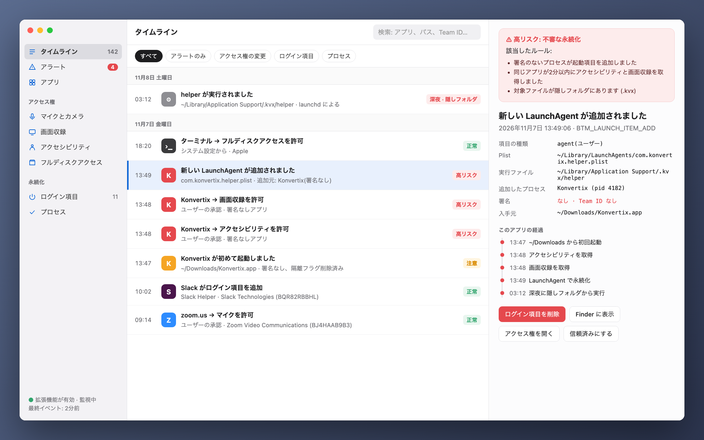
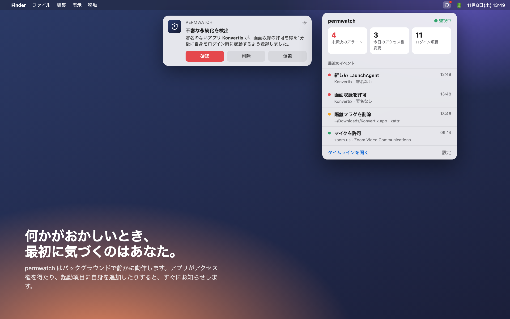
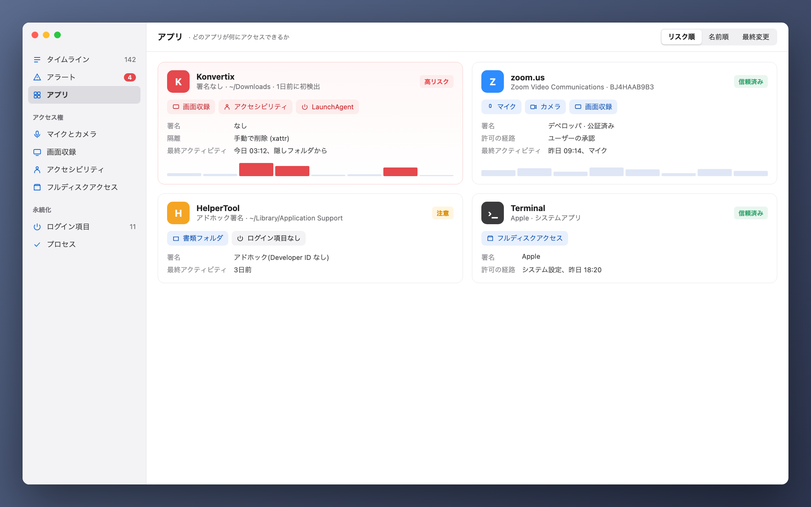

[Türkçe](README_tr.md) · [English](README.md) · [Русский](README_ru.md) · [Deutsch](README_de.md) · [Français](README_fr.md) · [Español](README_es.md) · [Português](README_pt.md) · [Italiano](README_it.md) · [Українська](README_uk.md) · **日本語** · [简体中文](README_zh.md) · [한국어](README_ko.md) · [العربية](README_ar.md)

# permwatch

**Mac のアプリが何にアクセスできるのかを、ひと目で。**

カメラ、マイク、画面収録、ログイン項目。 
permwatch はアクセス権の変更をすべて記録し、怪しい動きがあればすぐにお知らせします。

---

## 許可して、忘れてしまう

「画面収録を許可してください」「アクセシビリティへのアクセスが必要です」「ログイン時に開きますか?」

私たちは毎日何十回も「OK」を押しています。でも、どのアプリに、いつ、どんな許可を与えたか覚えていますか?
どのアプリがこっそり起動項目に自分を追加したでしょう? macOS はその答えを見せてくれません。

**permwatch なら見せてくれます。**

  

## ある日のシナリオ

無料の PDF 変換アプリをダウンロードします。開くといくつかの許可を求められ、「OK」を押します。
何も変わったところはないように見えます。

その裏で、permwatch はこんな動きを捉えています。

| 時刻 | 起きたこと |
|---|---|
| 13:46 | ダウンロードしたアプリの**隔離フラグが削除され**、Gatekeeper が回避された |
| 13:47 | **署名のない**アプリがダウンロードフォルダから初めて起動した |
| 13:48 | 1分のうちに**アクセシビリティ**と**画面収録**の両方の許可を得た |
| 13:49 | **隠しフォルダ内のプログラムを起動項目に追加**した |
| 03:12 | 深夜、あなたが眠っている間に**その隠しプログラムが実行された** |

一つひとつは無害に見えても、つなげるとよく知られた攻撃の流れになります。
permwatch はそれらを結びつけ、ひとつのわかりやすいアラートにして伝えます。

  

## できること

- 🕒 **タイムライン:** アクセス権の変更と新しい起動項目を、日時と原因となったプロセスとともに記録
- 🚨 **スマートなアラート:** 署名のないアプリ、深夜の動き、Gatekeeper の回避を検知
- 🔍 **アプリごとの表示:** アプリが持つすべての許可を1枚のカードで確認
- 🧬 **署名チェック:** Apple か、既知のデベロッパか、それとも出所不明か
- 📍 **メニューバーに常駐:** 普段は控えめに、必要なときだけ知らせます

  

## プライバシーはあなたの手元に

permwatch は**データを一切外部に送信しません。** 解析も、アカウントも、クラウドもありません。
記録はすべてあなたの Mac の中だけに残ります。プライバシーツールとして当然のことです。

## しくみ

permwatch は、セキュリティソフトウェア向けの Apple 公式フレームワーク **Endpoint Security** を使っています。
コアは C で書かれています。**観察するだけ**で、システムの動作に干渉することはありません。

## 現在の状況

permwatch は現在活発に開発中です。

- ✅ イベントを捉えるコアエンジン(コマンドライン)
- ⏳ Apple の Endpoint Security 権限: 申請済み、審査中
- 🛠 macOS アプリとインターフェイス: デザイン段階

> 上の画像はデザインのプレビューです。シナリオに登場する「Konvertix」は架空のアプリです。

デベロッパの方でコアを試してみたい場合は: **[開発者ガイド(英語)→](docs/GELISTIRME_en.md)**

---

macOS のセキュリティに興味を持つ人が、同じく好奇心旺盛な人のために作りました。

