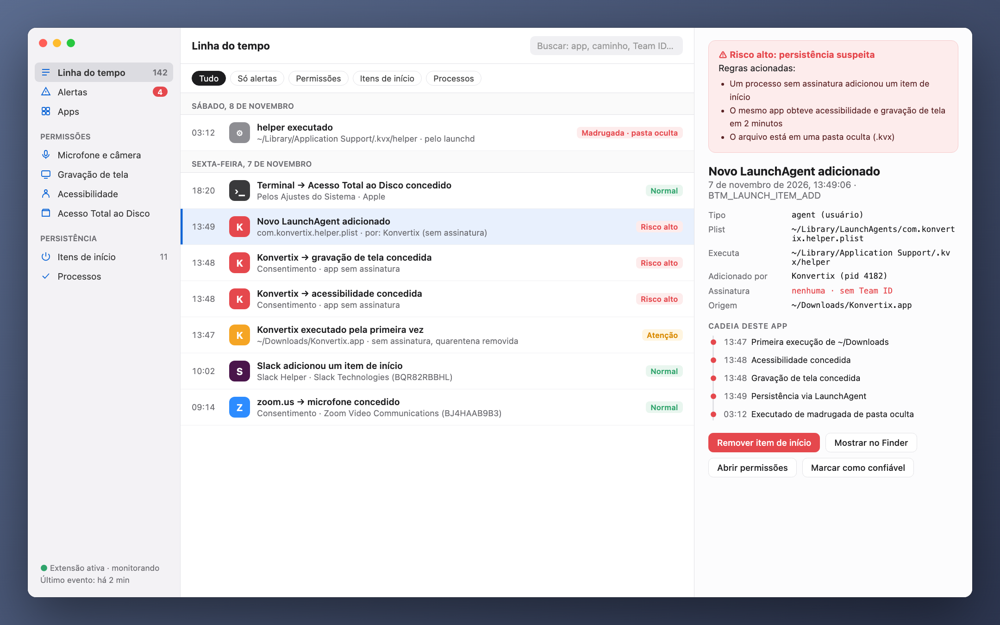
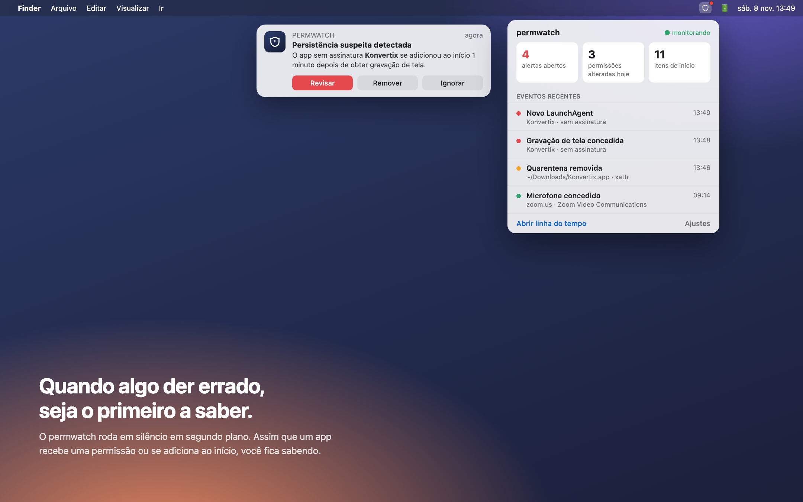
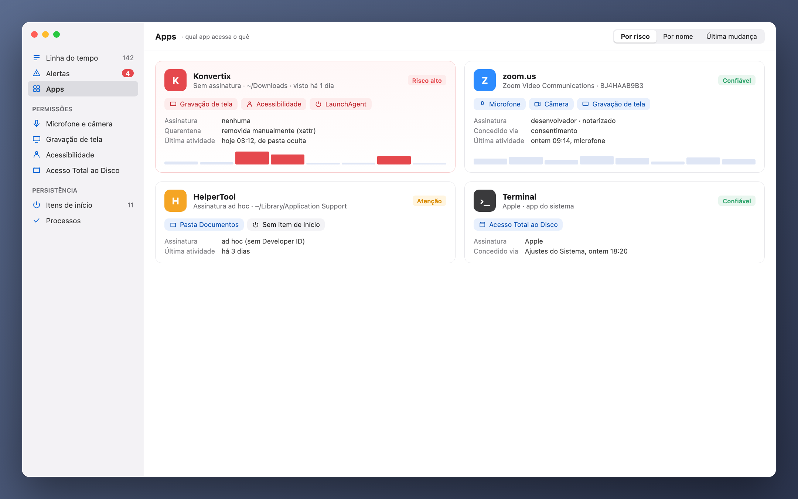

[Türkçe](README_tr.md) · [English](README.md) · [Русский](README_ru.md) · [Deutsch](README_de.md) · [Français](README_fr.md) · [Español](README_es.md) · **Português** · [Italiano](README_it.md) · [Українська](README_uk.md) · [日本語](README_ja.md) · [简体中文](README_zh.md) · [한국어](README_ko.md) · [العربية](README_ar.md)

# permwatch

**Veja o que cada app do seu Mac pode acessar.**

Câmera, microfone, gravação de tela, itens de início. 
O permwatch registra cada mudança de permissão e avisa você assim que algo parecer estranho.

---

## Você permitiu e esqueceu

"Permitir gravação de tela." "Acesso de acessibilidade necessário." "Abrir ao iniciar sessão?"

Clicamos em "OK" dezenas de vezes por dia. Mas qual app recebeu qual permissão, e quando?
Qual delas se adicionou em silêncio ao início? O macOS não mostra essas respostas.

**O permwatch mostra.**

  

## Um cenário

Você baixa um conversor de PDF gratuito. Abre, ele pede algumas permissões, você clica em "OK".
Tudo parece normal.

Enquanto isso, o permwatch vê o seguinte em segundo plano:

| Hora | O que aconteceu |
|---|---|
| 13:46 | A **marca de quarentena** do app baixado **foi removida**, contornando o Gatekeeper |
| 13:47 | Um app **sem assinatura** foi executado pela primeira vez a partir de Downloads |
| 13:48 | Em um minuto ele obteve **acessibilidade** e **gravação de tela** |
| 13:49 | Ele **adicionou ao início um programa de uma pasta oculta** |
| 03:12 | De madrugada, enquanto você dormia, **esse programa oculto foi executado** |

Cada passo, sozinho, parece inofensivo. Juntos, formam uma cadeia de ataque conhecida.
O permwatch liga os pontos e mostra um único alerta claro.

  

## O que ele faz

- 🕒 **Linha do tempo:** cada mudança de permissão e cada novo item de início, com data e o processo responsável
- 🚨 **Alertas inteligentes:** apps sem assinatura, atividade de madrugada, tentativas de contornar o Gatekeeper
- 🔍 **Visão por app:** todas as permissões de um app em um único cartão
- 🧬 **Verificação de assinatura:** Apple, um desenvolvedor conhecido ou uma fonte desconhecida?
- 📍 **Na barra de menus:** não atrapalha, mas avisa quando importa

  

## Sua privacidade fica com você

O permwatch **não envia nenhum dado.** Sem análises, sem conta, sem nuvem.
Todos os registros ficam no seu Mac. É o mínimo que se espera de uma ferramenta de privacidade.

## Como funciona

O permwatch usa o **Endpoint Security**, o framework oficial da Apple para software de segurança.
O núcleo é escrito em C. Ele apenas **observa** e nunca interfere no funcionamento do sistema.

## Status

O permwatch está em desenvolvimento ativo.

- ✅ Motor que captura eventos (linha de comando)
- ⏳ Permissão de Endpoint Security da Apple: solicitada, em análise
- 🛠 App para macOS e interface: em design

> As imagens acima são prévias de design. "Konvertix" no cenário é um app fictício.

É desenvolvedor e quer testar o núcleo? **[Guia do desenvolvedor (em inglês) →](docs/GELISTIRME_en.md)**

---

Feito por alguém curioso sobre segurança no macOS, para os curiosos.

