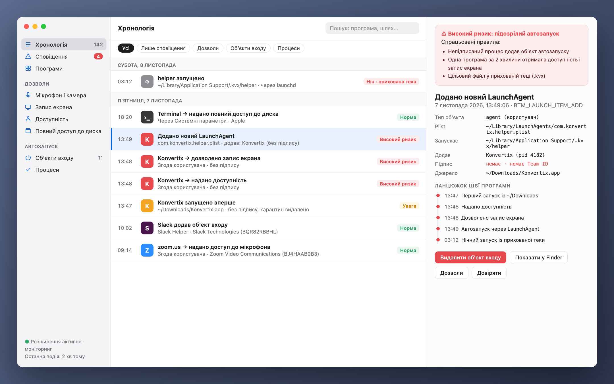
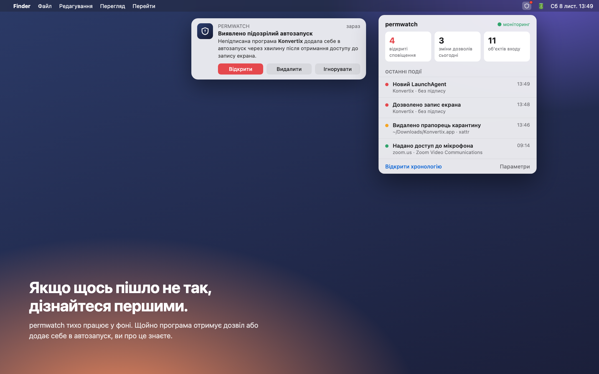
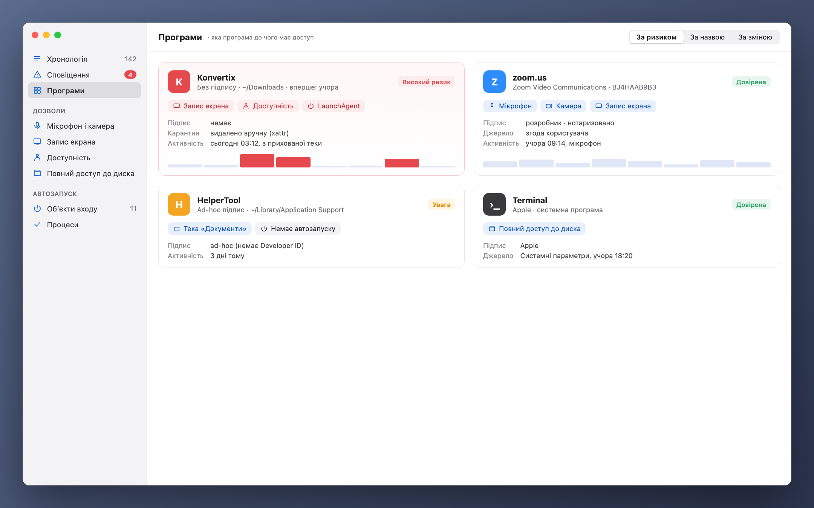

[Türkçe](README_tr.md) · [English](README.md) · [Русский](README_ru.md) · [Deutsch](README_de.md) · [Français](README_fr.md) · [Español](README_es.md) · [Português](README_pt.md) · [Italiano](README_it.md) · **Українська** · [日本語](README_ja.md) · [简体中文](README_zh.md) · [한국어](README_ko.md) · [العربية](README_ar.md)

# permwatch

**Дізнайтеся, до чого має доступ кожна програма на вашому Mac.**

Камера, мікрофон, запис екрана, об’єкти автозапуску. 
permwatch веде журнал усіх змін дозволів і одразу попереджає про підозрілі.

---

## Дозволили й забули

«Дозволити запис екрана». «Потрібен доступ до функцій доступності». «Відкривати під час входу?»

Ми натискаємо «OK» десятки разів на день. Але якій програмі й коли ви надали який дозвіл?
Яка з них тихо додала себе в автозапуск? macOS не показує відповідей на ці питання.

**permwatch показує.**

  

## Сценарій

Ви завантажуєте безкоштовний конвертер PDF. Відкриваєте його, він просить кілька дозволів, ви натискаєте «OK».
Усе виглядає як зазвичай.

А permwatch тим часом бачить у фоні таке:

| Час | Що сталося |
|---|---|
| 13:46 | У завантаженої програми **видалено прапорець карантину**, тобто Gatekeeper обійдено |
| 13:47 | **Непідписану** програму вперше запущено з «Завантажень» |
| 13:48 | За хвилину вона отримала і **доступність**, і **запис екрана** |
| 13:49 | Вона **додала в автозапуск програму з прихованої теки** |
| 03:12 | Уночі, поки ви спали, **ця прихована програма запустилася** |

Окремо кожен крок виглядає нешкідливо. Разом вони складаються у знайомий ланцюжок атаки.
permwatch пов’язує їх і показує одне зрозуміле сповіщення.

  

## Можливості

- 🕒 **Хронологія:** кожна зміна дозволів і кожен новий об’єкт автозапуску, з датою та відповідальним процесом
- 🚨 **Розумні сповіщення:** непідписані програми, нічна активність, спроби обійти Gatekeeper
- 🔍 **Картка програми:** усі дозволи програми в одному місці
- 🧬 **Перевірка підпису:** Apple, відомий розробник чи невідоме джерело?
- 📍 **У рядку меню:** не заважає, але вчасно попереджає

  

## Ваша приватність залишається з вами

permwatch **нікуди не надсилає даних.** Жодної аналітики, облікових записів чи хмари.
Усі записи зберігаються лише на вашому Mac. Від інструмента для приватності іншого й не чекаєш.

## Як це працює

permwatch використовує **Endpoint Security**, офіційний фреймворк Apple для програм безпеки.
Ядро написане на C. Воно лише **спостерігає** й ніколи не втручається в роботу системи.

## Статус

permwatch перебуває в активній розробці.

- ✅ Ядро, що перехоплює події (командний рядок)
- ⏳ Дозвіл Apple на Endpoint Security: заявку подано, на розгляді
- 🛠 Програма для macOS та інтерфейс: на етапі дизайну

> Зображення вище є попереднім дизайном. Програма «Konvertix» у сценарії вигадана.

Ви розробник і хочете спробувати ядро? **[Посібник для розробників (англійською) →](docs/GELISTIRME_en.md)**

---

Створено людиною, якій цікава безпека macOS, для таких самих допитливих.

