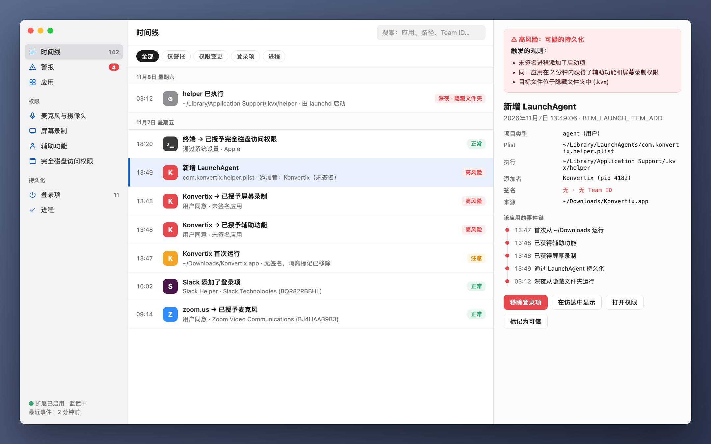
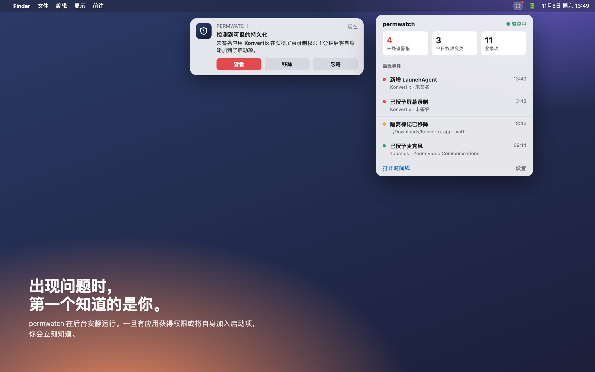
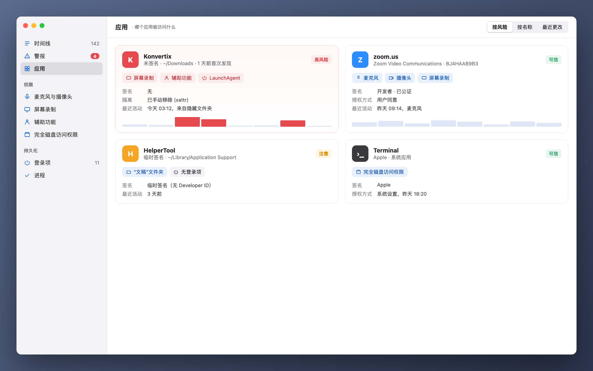

[Türkçe](README_tr.md) · [English](README.md) · [Русский](README_ru.md) · [Deutsch](README_de.md) · [Français](README_fr.md) · [Español](README_es.md) · [Português](README_pt.md) · [Italiano](README_it.md) · [Українська](README_uk.md) · [日本語](README_ja.md) · **简体中文** · [한국어](README_ko.md) · [العربية](README_ar.md)

# permwatch

**看清 Mac 上每个应用都能访问什么。**

摄像头、麦克风、屏幕录制、登录项。 
permwatch 记录每一次权限变更，一旦发现可疑情况立即提醒你。

---

## 点了"允许"，然后就忘了

"允许屏幕录制。""需要辅助功能权限。""登录时打开？"

我们每天要点几十次"好"。可你还记得哪个应用在什么时候获得了什么权限吗？
又是哪个应用悄悄把自己加进了启动项？macOS 不会告诉你答案。

**permwatch 会。**

  

## 一个场景

你下载了一个免费的 PDF 转换工具。打开后它请求了几项权限，你点了"好"。
一切看起来都很正常。

与此同时，permwatch 在后台看到了这些：

| 时间 | 发生了什么 |
|---|---|
| 13:46 | 下载的应用的**隔离标记被移除**，绕过了 Gatekeeper |
| 13:47 | 一个**未签名**的应用首次从"下载"文件夹运行 |
| 13:48 | 一分钟内同时获得了**辅助功能**和**屏幕录制**权限 |
| 13:49 | 它**把隐藏文件夹中的程序加入了启动项** |
| 03:12 | 深夜你熟睡时，**那个隐藏程序运行了** |

单独看，每一步都显得无害。放在一起，就是一条熟悉的攻击链。
permwatch 会把这些线索串联起来，只给你一条清晰的警报。

  

## 功能

- 🕒 **时间线：** 每一次权限变更和每一个新的启动项，附带时间和负责的进程
- 🚨 **智能警报：** 未签名应用、深夜活动、绕过 Gatekeeper 的尝试
- 🔍 **应用视图：** 一张卡片看清一个应用拥有的全部权限
- 🧬 **签名检查：** 是 Apple、知名开发者，还是来路不明？
- 📍 **常驻菜单栏：** 平时不打扰，关键时刻及时提醒

  

## 你的隐私只属于你

permwatch **不会向任何地方发送数据。** 没有统计分析，没有账户，没有云端。
所有记录都只保存在你的 Mac 上。对一款隐私工具来说，这本该如此。

## 工作原理

permwatch 使用 Apple 为安全软件提供的官方框架 **Endpoint Security**。
核心用 C 编写。它只负责**观察**，从不干预系统的正常运行。

## 当前状态

permwatch 正在积极开发中。

- ✅ 捕获事件的核心引擎（命令行）
- ⏳ Apple Endpoint Security 权限：已提交申请，正在审核
- 🛠 macOS 应用与界面：设计阶段

> 以上图片为设计预览。场景中的"Konvertix"是虚构的应用。

如果你是开发者，想试用核心引擎：**[开发者指南（英文）→](docs/GELISTIRME_en.md)**

---

由一位对 macOS 安全充满好奇的人，为同样好奇的你打造。

