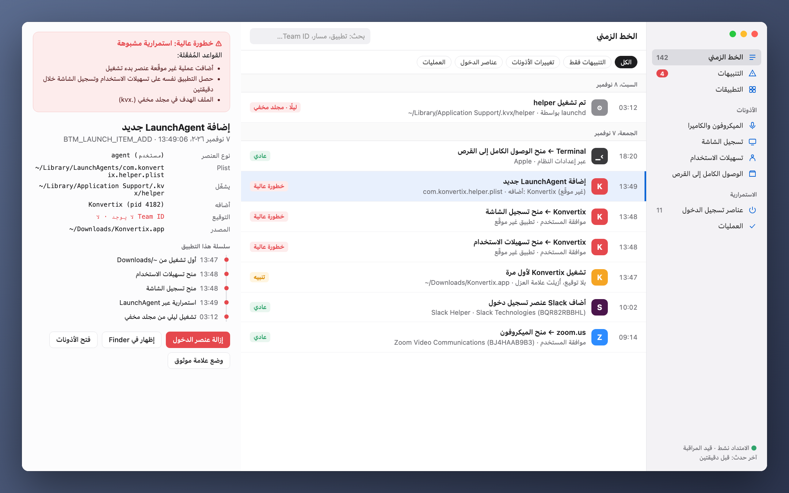
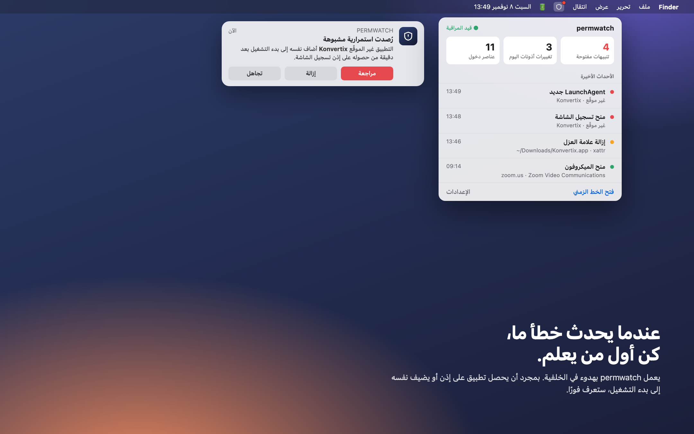
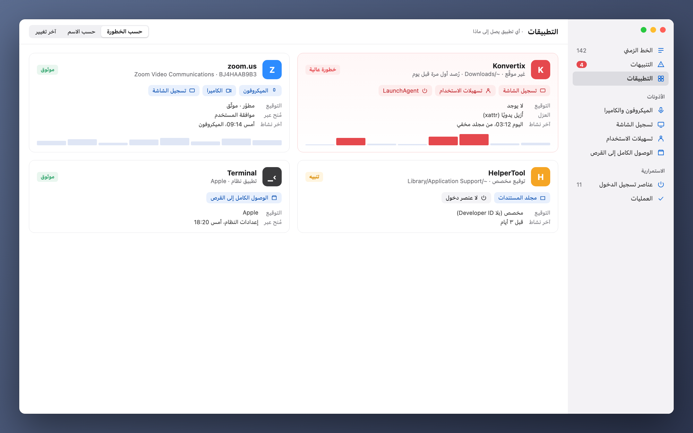

[Türkçe](README_tr.md) · [English](../../README.md) · [Русский](README_ru.md) · [Deutsch](README_de.md) · [Français](README_fr.md) · [Español](README_es.md) · [Português](README_pt.md) · [Italiano](README_it.md) · [Українська](README_uk.md) · [日本語](README_ja.md) · [简体中文](README_zh.md) · [한국어](README_ko.md) · **العربية**

Apple Silicon وIntel · macOS 14 أو أحدث · مجاني 
افتح ملف zip واسحب **permwatch** إلى مجلد التطبيقات.

# permwatch

**اعرف ما الذي يستطيع كل تطبيق على جهاز Mac الوصول إليه.**

الكاميرا، الميكروفون، تسجيل الشاشة، عناصر تسجيل الدخول. 
يسجّل permwatch كل تغيير في الأذونات وينبّهك فورًا عندما يبدو شيء ما مريبًا.

---

## سمحتَ ثم نسيت

«اسمح بتسجيل الشاشة.» «مطلوب الوصول إلى تسهيلات الاستخدام.» «هل تريد الفتح عند تسجيل الدخول؟»

نضغط «موافق» عشرات المرات يوميًا. لكن أي تطبيق منحته أي إذن، ومتى؟
وأيها أضاف نفسه بهدوء إلى بدء التشغيل؟ لا يُظهر لك macOS هذه الإجابات.

**أما permwatch فيُظهرها.**

  

## سيناريو

تنزّل محوّل PDF مجانيًا. تفتحه، فيطلب بعض الأذونات، فتضغط «موافق».
كل شيء يبدو طبيعيًا.

في هذه الأثناء، يرى permwatch في الخلفية ما يلي:

| الوقت | ما الذي حدث |
|---|---|
| 13:46 | **أُزيلت علامة العزل** عن التطبيق المنزَّل، أي جرى تجاوز Gatekeeper |
| 13:47 | تطبيق **غير موقّع** يعمل لأول مرة من مجلد التنزيلات |
| 13:48 | خلال دقيقة واحدة حصل على **تسهيلات الاستخدام** و**تسجيل الشاشة** معًا |
| 13:49 | **أضاف إلى بدء التشغيل برنامجًا من مجلد مخفي** |
| 03:12 | في منتصف الليل وأنت نائم، **عمل ذلك البرنامج المخفي** |

كل خطوة بمفردها تبدو بريئة. لكنها معًا تشكّل سلسلة هجوم معروفة.
يربط permwatch هذه النقاط ويعرض لك تنبيهًا واحدًا واضحًا.

  

## ماذا يفعل

- 🛡 **نظرة عامة وفحص بنقرة:** حكم واضح عند الفتح. «افحص جهازي» يشغّل فحص البرمجيات الخبيثة ويتحقق من اختطاف المتصفح، واعتراض الحركة (شهادات الجذر، ملفات التعريف، الوكيل، DNS، VPN)، وتسرّب الـ VPN، والوصول عن بُعد، وتركيبات الأذونات المعتادة لبرامج التجسس. لكل نتيجة زر إصلاح.
- 🐞 **فحص البرامج الضارة:** يفحص تطبيقاتك وعناصر بدء التشغيل والبرامج العاملة والتنزيلات باستخدام **تواقيع XProtect من Apple** و**قواعد Elastic Security المفتوحة للبرامج الضارة على macOS**، عبر محرك YARA مفتوح المصدر. يستغرق الفحص السريع نحو 10 ثوانٍ. يمكن نقل ما يُعثر عليه إلى الحجر مع عناصر بدء التشغيل التي تشغّله: لن يعمل بعد ذلك، ويمكنك استعادته إن كان إنذارًا خاطئًا.
- 🛡️ **الحماية في الوقت الفعلي:** تُفحص خلال ثوانٍ الملفات الجديدة أو المعدلة في التطبيقات والتنزيلات وعناصر بدء التشغيل والمجلدات التي تختبئ فيها البرامج الضارة. تُراقَب مستنداتك من برامج الفدية (تشفير ملفات كثيرة فجأة)، ويُوقف البرنامج المسؤول مؤقتًا إن كان غير موقّع. تُميَّز الاتصالات بخوادم مدرجة في قوائم البرامج الضارة المعروفة (abuse.ch)، وأنت تقرر حظرها أو لا.
- 🧭 **بسيط ومحدّث:** دليل ترحيبي قصير، ووضع بسيط يعرض ما يحتاجه معظم الناس فقط (والباقي في الوضع المتقدم)، وتحديثات داخل التطبيق مع شريط تقدّم، و**المساعدة › أبلغ عن مشكلة** التي تفتح رسالة بريد بالتفاصيل التقنية جاهزة.
- 🔐 **الأذونات:** سجل كل تغيير، والأذونات المتبقية من تطبيقات محذوفة، والسحب بنقرة، وإزالة التطبيقات.
- 🌐 **الشبكة:** أي تطبيق يتصل بأين، والتقاط الحزم مع أسماء العمليات وشروح مبسّطة، وحظر خادم بجدار حماية macOS المدمج.
- ⬇️ **التنزيلات، 🎙 الميكروفون والكاميرا، ⌨️ الطرفية** مع أوامر أمان جاهزة.

  

## ما ليس عليه

permwatch **لا يغني عن برنامج مكافحة فيروسات تجاري لديه فريق أبحاث خاص.** تأتي تواقيعه من Apple (XProtect) وElastic Security وقوائم الخوادم من abuse.ch، لذا يكتشف ما تعرفه هذه المصادر. تعمل الحماية في الوقت الفعلي عبر أحداث نظام الملفات: يُفحص الملف الجديد خلال ثوانٍ، لكن لا يمكن إيقاف برنامج *قبل* أن يبدأ. يتطلب ذلك إذن Endpoint Security من Apple، وقد تقدمنا بطلبه. لا تُحظر الاتصالات بالخوادم الضارة المعروفة تلقائيًا أبدًا؛ تُسأل أولًا.

القواعد استدلالية: قد تعطي إنذارات خاطئة (مثلًا مع أدوات المطورين) وقد تفوّت برامج ضارة مخفية جيدًا.

## خصوصيتك تبقى معك

لا يرسل permwatch **أي شيء عنك.** لا تحليلات ولا حساب ولا سحابة. التفاصيل: **[PRIVACY.md](../../PRIVACY.md)**

## كيف يعمل

- يقرأ قاعدة أذونات macOS وعناصر بدء التشغيل (بالوصول الكامل إلى القرص) ويراقب التغييرات.
- يُثبَّت **وضع المسؤول** الاختياري كخدمة نظام (SMAppService) بعد موافقة واحدة، ويتحقق macOS من التوقيع.
- يستخدم التقاط الحزم libpcap وPKTAP من Apple (العملية لكل حزمة).
- محرك Endpoint Security ‏(C) للأحداث الفورية جاهز وينتظر إذن Apple.

## شيفرة طرف ثالث

- [YARA](https://github.com/VirusTotal/yara) v4.5.8 (BSD-3-Clause)
- [SwiftTerm](https://github.com/migueldeicaza/SwiftTerm) v1.20.0 (MIT)

## الحالة

- ✅ تطبيق macOS لمعالجات Apple Silicon وIntel: فحص البرامج الضارة مع حماية في الوقت الفعلي وحجر، وحماية من برامج الفدية، وفحص الخوادم الضارة، والأذونات، وعناصر بدء التشغيل، وفحوص المتصفح والوصول عن بعد، والشبكة والتقاط الحزم. تصل التحديثات داخل التطبيق. متاح بـ 13 لغة.
- ⏳ إذن Apple لـ Endpoint Security: قيد المراجعة.

هل أنت مطوّر وتريد تجربة النواة؟ **[دليل المطوّر (بالإنجليزية) ←](../GELISTIRME_en.md)**

## ☕ هل تشتري لي فنجان قهوة؟

permwatch مجاني ومفتوح المصدر، بلا إعلانات أو حسابات أو تتبع. إذا ساعدك، فتبرع صغير يساعد على استمراره. أرسل كل عملة عبر الشبكة المذكورة فقط.

| العملة | العنوان |
|---|---|
| Bitcoin (BTC) · Taproot | `bc1pyuwdr40733dtzkeefj6xu3asnncwa0a67q2q6sw7fuut4zfhx8yqf2ta3l` |
| Bitcoin (BTC) · SegWit | `bc1qevw8l3pwfahysgmxy0vhv2srnk0dcyze7pggq8` |
| Monero (XMR) | `42tsRvBWbPujgVpQdNy6Ba6ovKNcPkxQBKWn1rYcENDpAPTuvQ2ejxCXcUc5KJQTdkHicn4agR7GnYroSUGQLzVhL93KmTt` |
| Ethereum (ERC-20): ETH, USDC, USDT, SHIB, LINK, UNI | `0xCD9ab39db50A830e157776a97bc9Ae21811e3177` |
| Litecoin (LTC) · SegWit | `ltc1qx40ryzy34vf5977aq5uk3rpqm7err5jvf7gcwl` |
| Litecoin (LTC) · Legacy | `LV6kxUc84QoHq7zGZBz1T38vwdcAXQPxR1` |
| Dogecoin (DOGE) | `DTtZ7oJELg9hs43o1g97qVM676H46XorAT` |
| Solana (SOL) | `5uwHKnCMFbFpob2ssypd69svUFCYZQePCwZcQfELckAD` |
| Xelis (XEL) | `xel:h2mt8pc2059rgq3x67xhndqfm8xukrn49zx2la7qmjqnwhgftc4qqasdzay` |
| Banano (BAN) | `ban_1teuphtrxw6rtr7ttr7iaxtaspm11wjqhjh6j84twcp6pcbiyb4cgzth9439` |

---

صُنع بيد شخص شغوف بأمان macOS، لكل الفضوليين.

