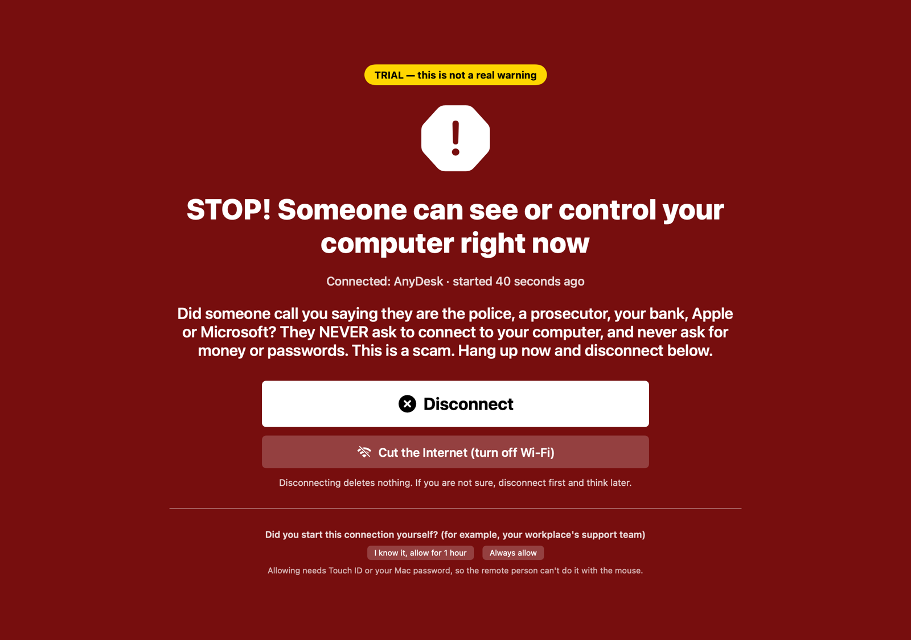
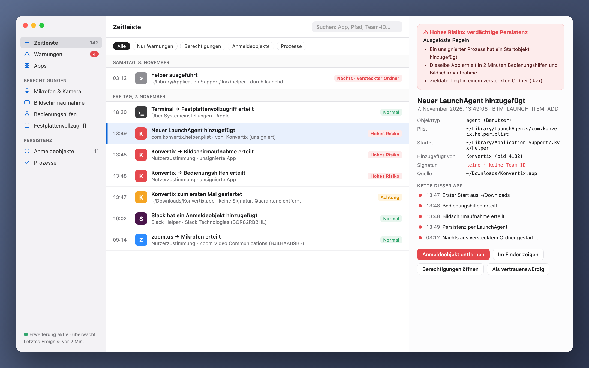
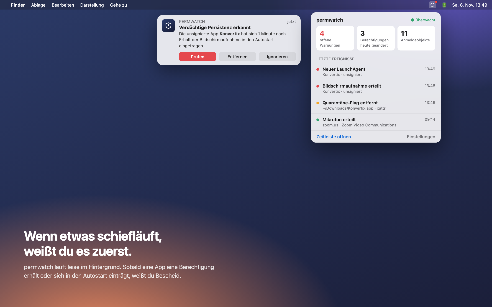
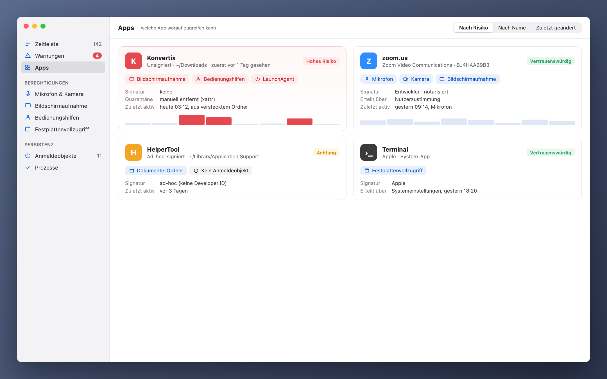

[Türkçe](README_tr.md) · [English](../../README.md) · [Русский](README_ru.md) · **Deutsch** · [Français](README_fr.md) · [Español](README_es.md) · [Português](README_pt.md) · [Italiano](README_it.md) · [Українська](README_uk.md) · [日本語](README_ja.md) · [简体中文](README_zh.md) · [한국어](README_ko.md) · [العربية](README_ar.md)

# permwatch

**Sieh, worauf jede App auf deinem Mac zugreifen kann.**

Kamera, Mikrofon, Bildschirmaufnahme, Anmeldeobjekte. 
permwatch protokolliert jede Änderung an Berechtigungen und warnt dich sofort, wenn etwas verdächtig ist.

Apple Silicon & Intel · macOS 14 oder neuer · kostenlos 
Öffne die ZIP-Datei und ziehe **permwatch** in den Ordner „Programme“.

---

## 📞 Stoppt Telefonbetrüger

Jemand ruft an, gibt sich als Polizei, Bank oder Support aus und lässt dich AnyDesk oder Ähnliches installieren. Dann sieht er deinen Bildschirm, während du dich bei deiner Bank anmeldest. Virenscanner verhindern das nicht, denn diese Programme sind keine Schadsoftware.

**permwatch schon.** Sobald jemand deinen Mac aus der Ferne sieht oder steuert, erscheint eine bildschirmfüllende Warnung, auch per Sprache. Ein Klick trennt die Verbindung, blockiert die Server und entfernt die Rechte. Öffnest du währenddessen eine Bank-Website, wird die Warnung noch deutlicher, und danach sagt permwatch dir genau, was zu tun ist. Hilfst du selbst jemandem per AnyDesk, passiert nichts: nur wenn dein Bildschirm gesendet wird.

  

## Erlaubt und vergessen

„Bildschirmaufnahme erlauben.“ „Zugriff auf Bedienungshilfen erforderlich.“ „Beim Anmelden öffnen?“

Wir klicken jeden Tag dutzende Male auf „OK“. Aber welcher App hast du wann welche Berechtigung gegeben?
Welche hat sich still und leise in den Autostart eingetragen? macOS zeigt dir die Antworten nicht.

**permwatch schon.**

  

## Ein Szenario

Du lädst einen kostenlosen PDF-Konverter herunter. Du öffnest ihn, er fragt nach ein paar Berechtigungen, du klickst „OK“.
Alles wirkt normal.

permwatch sieht im Hintergrund dagegen Folgendes:

| Uhrzeit | Was passiert ist |
|---|---|
| 13:46 | Das **Quarantäne-Flag** der heruntergeladenen App **wurde entfernt**, Gatekeeper also umgangen |
| 13:47 | Eine **unsignierte** App startete zum ersten Mal aus dem Downloads-Ordner |
| 13:48 | Innerhalb einer Minute erhielt sie **Bedienungshilfen** und **Bildschirmaufnahme** |
| 13:49 | Sie **trug ein Programm aus einem versteckten Ordner in den Autostart ein** |
| 03:12 | Mitten in der Nacht, während du schliefst, **lief dieses versteckte Programm** |

Einzeln wirkt jeder Schritt harmlos. Zusammen ergeben sie eine bekannte Angriffskette.
permwatch verbindet die Punkte und zeigt dir eine einzige, klare Warnung.

  

## Was es kann

- 🛡 **Übersicht und Prüfung mit einem Klick:** klares Urteil beim Start. „Mac prüfen“ startet den Malware-Scan und prüft Browser-Hijacking, Abfangen von Verkehr (Root-Zertifikate, Profile, Proxy, DNS, VPN), VPN-Lecks, Fernzugriff und spywareartige Rechte-Kombinationen. Jeder Fund hat einen Knopf zum Beheben.
- 🐞 **Malware-Scan:** Prüft deine Apps, Anmeldeobjekte, laufenden Programme und Downloads mit **Apples XProtect-Signaturen** und den **offenen macOS-Malware-Regeln von Elastic Security**, mit der Open-Source-Engine YARA. Ein Schnellscan dauert etwa 10 Sekunden. Funde lassen sich zusammen mit den Anmeldeobjekten, die sie starten, in Quarantäne verschieben: Sie können nicht mehr laufen und lassen sich bei einem Fehlalarm wiederherstellen.
- 🛡️ **Echtzeitschutz:** Neue oder geänderte Dateien in Programme, Downloads, Anmeldeobjekten und den Ordnern, in denen sich Schadsoftware versteckt, werden innerhalb von Sekunden geprüft. Deine Dokumente werden auf Ransomware überwacht (viele Dateien plötzlich verschlüsselt); ein unsigniertes verantwortliches Programm wird angehalten. Verbindungen zu Servern auf bekannten Malware-Listen (abuse.ch) werden markiert, und du entscheidest, ob sie blockiert werden.
- 🧭 **Einfach und aktuell:** eine kurze Einführung, ein einfacher Modus mit nur dem Nötigsten (der Rest im erweiterten Modus), Updates direkt in der App mit Fortschrittsbalken und **Hilfe › Problem melden**, das eine E-Mail mit bereits ausgefüllten technischen Angaben öffnet.
- 🔐 **Berechtigungen:** Verlauf jeder Änderung, übrig gebliebene Rechte gelöschter Apps, Widerrufen mit einem Klick, Apps deinstallieren.
- 🌐 **Netzwerk:** welche App wohin verbindet, Paketmitschnitt mit Prozessnamen und verständlichen Erklärungen, Server mit der integrierten macOS-Firewall blockieren.
- ⬇️ **Downloads, 🎙 Mikrofon und Kamera, ⌨️ Terminal** mit fertigen Sicherheitsbefehlen.

  

## Was es nicht ist

permwatch **ersetzt kein kommerzielles Antivirenprogramm mit eigenem Forschungsteam.** Die Signaturen stammen von Apple (XProtect) und Elastic Security, die Serverlisten von abuse.ch; es findet also, was diese Quellen kennen. Der Echtzeitschutz arbeitet mit Dateisystem-Ereignissen: Eine neue Datei wird in Sekunden geprüft, aber ein Programm lässt sich nicht *vor* seinem Start stoppen. Dafür braucht es Apples Endpoint-Security-Berechtigung, die wir beantragt haben. Verbindungen zu bekannten schädlichen Servern werden nie automatisch blockiert; du wirst zuerst gefragt.

Die Regeln sind Heuristiken: Sie können Fehlalarme auslösen (etwa bei Entwicklerwerkzeugen) und gut versteckte Schadsoftware übersehen.

## Deine Privatsphäre bleibt bei dir

permwatch **sendet nichts über dich.** Keine Analyse, kein Konto, keine Cloud. Details: **[PRIVACY.md](../../PRIVACY.md)**

## So funktioniert es

- Liest die macOS-Berechtigungsdatenbank und Anmeldeobjekte (mit Festplattenvollzugriff) und überwacht Änderungen.
- Der optionale **Administratormodus** wird nach einer einmaligen Bestätigung als Systemdienst (SMAppService) installiert; macOS prüft die Signatur.
- Der Paketmitschnitt nutzt libpcap und Apples PKTAP (Prozess pro Paket).
- Ein Endpoint-Security-Kern (C) für Echtzeitereignisse ist fertig und wartet auf Apples Freigabe.

## Fremder Code

- [YARA](https://github.com/VirusTotal/yara) v4.5.8 (BSD-3-Clause)
- [SwiftTerm](https://github.com/migueldeicaza/SwiftTerm) v1.20.0 (MIT)

## Status

- ✅ macOS-App für Apple Silicon und Intel: Malware-Scan mit Echtzeitschutz und Quarantäne, Ransomware-Schutz, Prüfung auf schädliche Server, Berechtigungen, Anmeldeobjekte, Browser- und Fernzugriffsprüfungen, Netzwerk und Paketaufzeichnung. Updates kommen direkt in der App. In 13 Sprachen verfügbar.
- ⏳ Apple-Freigabe für Endpoint Security: in Prüfung.

Entwickler und möchtest den Kern ausprobieren? **[Entwicklerhandbuch (Englisch) →](../GELISTIRME_en.md)**

## ☕ Spendierst du mir einen Kaffee?

permwatch ist kostenlos und quelloffen, ohne Werbung, Konto oder Tracking. Wenn es dir geholfen hat, hält eine kleine Spende das Projekt am Leben. Sende jede Coin nur über das angegebene Netzwerk.

| Coin | Adresse |
|---|---|
| Bitcoin (BTC) · Taproot | `bc1pyuwdr40733dtzkeefj6xu3asnncwa0a67q2q6sw7fuut4zfhx8yqf2ta3l` |
| Bitcoin (BTC) · SegWit | `bc1qevw8l3pwfahysgmxy0vhv2srnk0dcyze7pggq8` |
| Monero (XMR) | `42tsRvBWbPujgVpQdNy6Ba6ovKNcPkxQBKWn1rYcENDpAPTuvQ2ejxCXcUc5KJQTdkHicn4agR7GnYroSUGQLzVhL93KmTt` |
| Ethereum (ERC-20): ETH, USDC, USDT, SHIB, LINK, UNI | `0xCD9ab39db50A830e157776a97bc9Ae21811e3177` |
| Litecoin (LTC) · SegWit | `ltc1qx40ryzy34vf5977aq5uk3rpqm7err5jvf7gcwl` |
| Litecoin (LTC) · Legacy | `LV6kxUc84QoHq7zGZBz1T38vwdcAXQPxR1` |
| Dogecoin (DOGE) | `DTtZ7oJELg9hs43o1g97qVM676H46XorAT` |
| Solana (SOL) | `5uwHKnCMFbFpob2ssypd69svUFCYZQePCwZcQfELckAD` |
| Xelis (XEL) | `xel:h2mt8pc2059rgq3x67xhndqfm8xukrn49zx2la7qmjqnwhgftc4qqasdzay` |
| Banano (BAN) | `ban_1teuphtrxw6rtr7ttr7iaxtaspm11wjqhjh6j84twcp6pcbiyb4cgzth9439` |

---

Gemacht von jemandem, der sich für macOS-Sicherheit begeistert, für alle Neugierigen.

