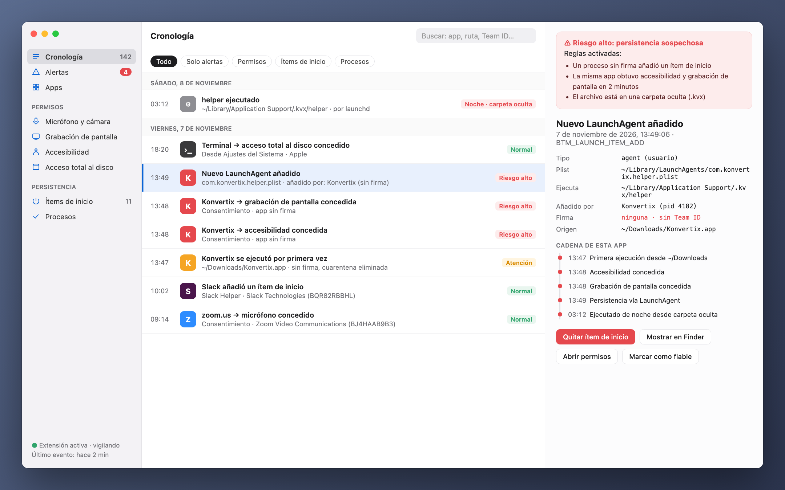
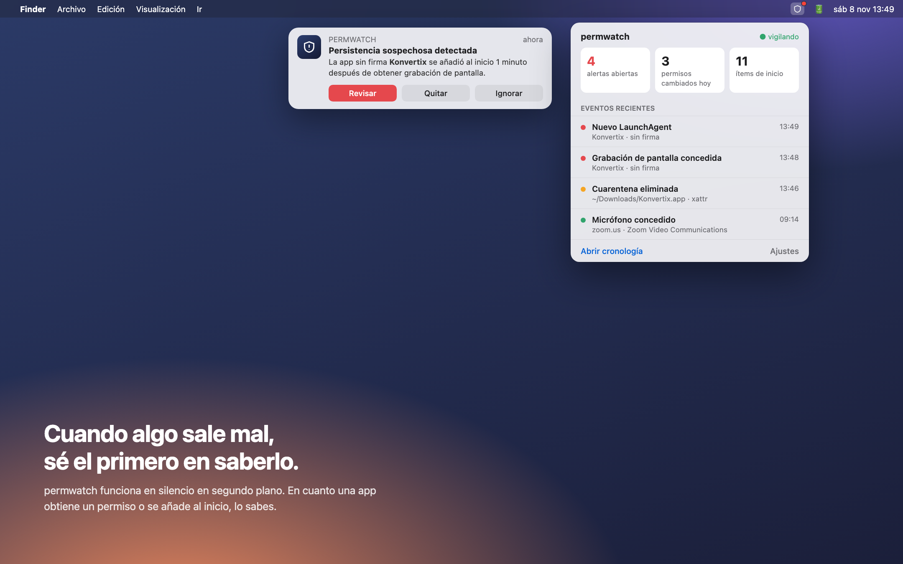
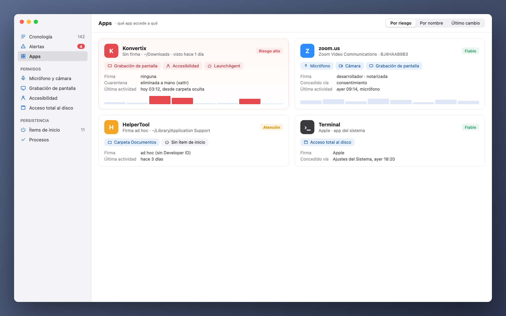

[Türkçe](README_tr.md) · [English](../../README.md) · [Русский](README_ru.md) · [Deutsch](README_de.md) · [Français](README_fr.md) · **Español** · [Português](README_pt.md) · [Italiano](README_it.md) · [Українська](README_uk.md) · [日本語](README_ja.md) · [简体中文](README_zh.md) · [한국어](README_ko.md) · [العربية](README_ar.md)

# permwatch

**Descubre a qué puede acceder cada app de tu Mac.**

Cámara, micrófono, grabación de pantalla, ítems de inicio. 
permwatch registra cada cambio de permisos y te avisa en cuanto algo no cuadra.

Apple Silicon e Intel · macOS 14 o posterior · gratis 
Abre el zip y arrastra **permwatch** a la carpeta Aplicaciones.

---

## Lo permitiste y lo olvidaste

«Permitir grabación de pantalla». «Se requiere acceso de accesibilidad». «¿Abrir al iniciar sesión?»

Pulsamos «Aceptar» decenas de veces al día. Pero ¿a qué app le diste qué permiso, y cuándo?
¿Cuál se añadió en silencio al inicio? macOS no te muestra las respuestas.

**permwatch, sí.**

  

## Un escenario

Descargas un conversor de PDF gratuito. Lo abres, te pide algunos permisos y pulsas «Aceptar».
Todo parece normal.

Mientras tanto, permwatch ve esto en segundo plano:

| Hora | Qué pasó |
|---|---|
| 13:46 | Se **eliminó la marca de cuarentena** de la app descargada: Gatekeeper quedó esquivado |
| 13:47 | Una app **sin firma** se ejecutó por primera vez desde Descargas |
| 13:48 | En un minuto obtuvo **accesibilidad** y **grabación de pantalla** |
| 13:49 | **Añadió al inicio un programa de una carpeta oculta** |
| 03:12 | A medianoche, mientras dormías, **ese programa oculto se ejecutó** |

Por separado, cada paso parece inofensivo. Juntos forman una cadena de ataque conocida.
permwatch une los puntos y te muestra una sola alerta clara.

  

## Qué hace

- 🛡 **Resumen y comprobación con un clic:** un veredicto claro al abrir. «Comprobar mi Mac» lanza el análisis de malware y revisa el secuestro del navegador, la intercepción del tráfico (certificados raíz, perfiles, proxy, DNS, VPN), fugas de VPN, acceso remoto y combinaciones de permisos típicas de spyware. Cada hallazgo tiene un botón para solucionarlo.
- 🐞 **Análisis de malware:** Revisa tus apps, ítems de inicio, programas en ejecución y descargas con las **firmas XProtect de Apple** y las **reglas abiertas de malware para macOS de Elastic Security**, usando el motor de código abierto YARA. Un análisis rápido tarda unos 10 segundos. Lo que encuentre puede ponerse en cuarentena junto con los ítems de inicio que lo ejecutan: ya no puede ejecutarse y puedes restaurarlo si era una falsa alarma.
- 🛡️ **Protección en tiempo real:** Los archivos nuevos o modificados en Aplicaciones, Descargas, ítems de inicio y las carpetas donde se esconde el malware se analizan en segundos. Tus documentos se vigilan contra el ransomware (muchos archivos cifrados de golpe) y el programa responsable se pausa si no está firmado. Las conexiones a servidores de listas de malware conocidas (abuse.ch) se señalan, y tú decides si bloquearlas.
- 🧭 **Sencillo y al día:** una breve guía de bienvenida, un modo simple con solo lo que la mayoría necesita (el resto en modo avanzado), actualizaciones dentro de la app con barra de progreso y **Ayuda › Informar de un problema**, que abre un correo con los detalles técnicos ya rellenados.
- 🔐 **Permisos:** historial de cada cambio, permisos que quedaron de apps borradas, revocar con un clic, desinstalar apps.
- 🌐 **Red:** qué app se conecta a dónde, captura de paquetes con nombres de proceso y explicaciones claras, bloqueo de servidores con el cortafuegos integrado de macOS.
- ⬇️ **Descargas, 🎙 micrófono y cámara, ⌨️ terminal** con comandos de seguridad listos para usar.

  

## Qué no es

permwatch **no sustituye a un antivirus comercial con su propio equipo de investigación.** Sus firmas vienen de Apple (XProtect) y Elastic Security, y sus listas de servidores de abuse.ch; así que encuentra lo que conocen esas fuentes. La protección en tiempo real funciona con eventos del sistema de archivos: un archivo nuevo se analiza en segundos, pero no se puede detener un programa *antes* de que arranque. Para eso hace falta el permiso Endpoint Security de Apple, que ya hemos solicitado. Las conexiones a servidores maliciosos conocidos nunca se bloquean automáticamente; primero se te pregunta.

Las reglas son heurísticas: pueden dar falsas alarmas (por ejemplo, con herramientas de desarrollo) y pueden pasar por alto malware bien escondido.

## Tu privacidad se queda contigo

permwatch **no envía nada sobre ti.** Sin análisis, sin cuenta, sin nube. Detalles: **[PRIVACY.md](../../PRIVACY.md)**

## Cómo funciona

- Lee la base de datos de permisos de macOS y los ítems de inicio (con acceso total al disco) y vigila los cambios.
- El **modo administrador** opcional se instala como servicio del sistema (SMAppService) tras una sola aprobación; macOS verifica la firma.
- La captura de paquetes usa libpcap y PKTAP de Apple (proceso por paquete).
- Un motor Endpoint Security (C) para eventos en tiempo real está listo y espera la autorización de Apple.

## Código de terceros

- [YARA](https://github.com/VirusTotal/yara) v4.5.8 (BSD-3-Clause)
- [SwiftTerm](https://github.com/migueldeicaza/SwiftTerm) v1.20.0 (MIT)

## Estado

- ✅ App para macOS en 13 idiomas, notarizada por Apple.
- ⏳ Autorización de Endpoint Security de Apple: en revisión.

¿Eres desarrollador y quieres probar el núcleo? **[Guía para desarrolladores (en inglés) →](../GELISTIRME_en.md)**

## ☕ ¿Me invitas a un café?

permwatch es gratuito y de código abierto, sin anuncios, cuentas ni rastreo. Si te ha servido, una pequeña donación ayuda a mantenerlo. Envía cada moneda solo por la red indicada.

| Moneda | Dirección |
|---|---|
| Bitcoin (BTC) · Taproot | `bc1pyuwdr40733dtzkeefj6xu3asnncwa0a67q2q6sw7fuut4zfhx8yqf2ta3l` |
| Bitcoin (BTC) · SegWit | `bc1qevw8l3pwfahysgmxy0vhv2srnk0dcyze7pggq8` |
| Monero (XMR) | `42tsRvBWbPujgVpQdNy6Ba6ovKNcPkxQBKWn1rYcENDpAPTuvQ2ejxCXcUc5KJQTdkHicn4agR7GnYroSUGQLzVhL93KmTt` |
| Ethereum (ERC-20): ETH, USDC, USDT, SHIB, LINK, UNI | `0xCD9ab39db50A830e157776a97bc9Ae21811e3177` |
| Litecoin (LTC) · SegWit | `ltc1qx40ryzy34vf5977aq5uk3rpqm7err5jvf7gcwl` |
| Litecoin (LTC) · Legacy | `LV6kxUc84QoHq7zGZBz1T38vwdcAXQPxR1` |
| Dogecoin (DOGE) | `DTtZ7oJELg9hs43o1g97qVM676H46XorAT` |
| Solana (SOL) | `5uwHKnCMFbFpob2ssypd69svUFCYZQePCwZcQfELckAD` |
| Xelis (XEL) | `xel:h2mt8pc2059rgq3x67xhndqfm8xukrn49zx2la7qmjqnwhgftc4qqasdzay` |
| Banano (BAN) | `ban_1teuphtrxw6rtr7ttr7iaxtaspm11wjqhjh6j84twcp6pcbiyb4cgzth9439` |

---

Hecho por alguien apasionado por la seguridad de macOS, para los curiosos.

