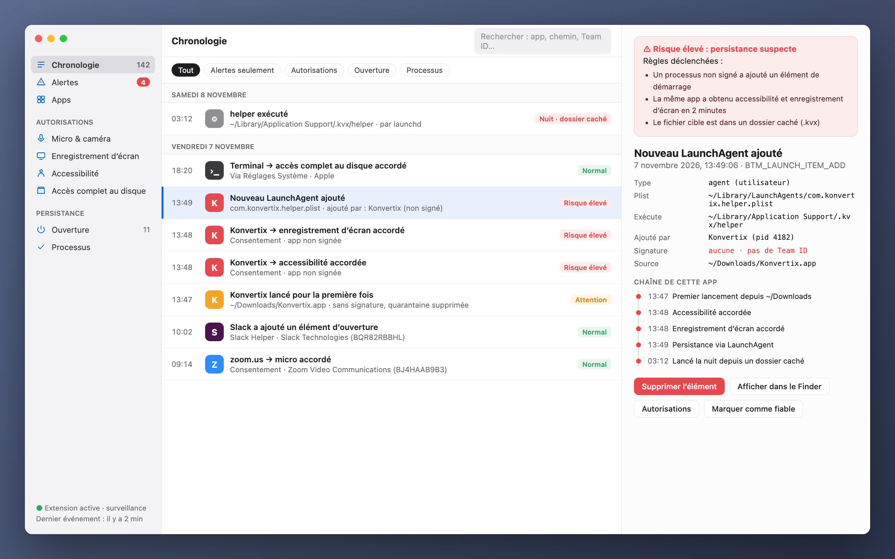
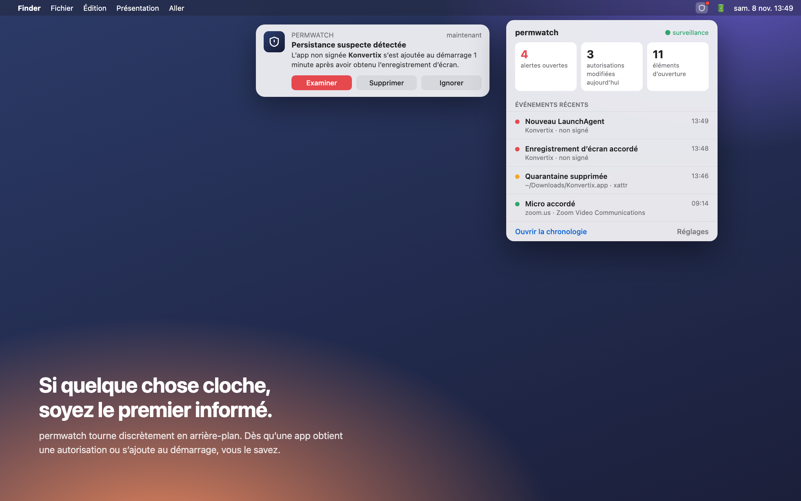
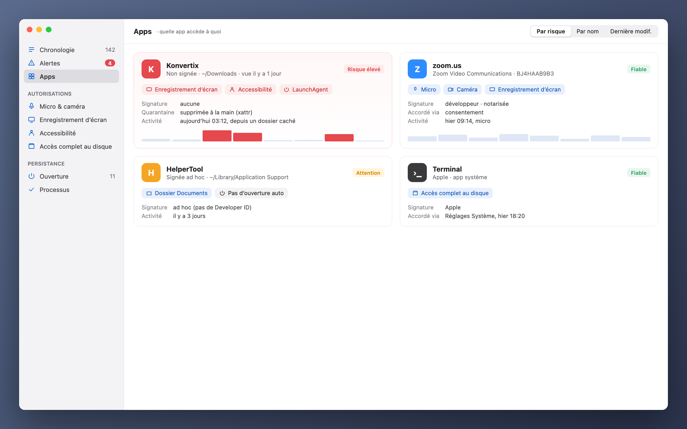

[Türkçe](README_tr.md) · [English](../../README.md) · [Русский](README_ru.md) · [Deutsch](README_de.md) · **Français** · [Español](README_es.md) · [Português](README_pt.md) · [Italiano](README_it.md) · [Українська](README_uk.md) · [日本語](README_ja.md) · [简体中文](README_zh.md) · [한국어](README_ko.md) · [العربية](README_ar.md)

# permwatch

**Voyez à quoi chaque app de votre Mac peut accéder.**

Caméra, micro, enregistrement d’écran, éléments d’ouverture. 
permwatch garde une trace de chaque changement d’autorisation et vous alerte dès que quelque chose cloche.

---

## Vous avez autorisé, puis oublié

« Autoriser l’enregistrement de l’écran. » « Accès à l’accessibilité requis. » « Ouvrir à la connexion ? »

Nous cliquons sur « OK » des dizaines de fois par jour. Mais quelle app a reçu quelle autorisation, et quand ?
Laquelle s’est discrètement ajoutée au démarrage ? macOS ne vous donne pas ces réponses.

**permwatch, si.**

  

## Un scénario

Vous téléchargez un convertisseur PDF gratuit. Vous l’ouvrez, il demande quelques autorisations, vous cliquez sur « OK ».
Tout semble normal.

Pendant ce temps, permwatch voit ceci en arrière-plan :

| Heure | Ce qui s’est passé |
|---|---|
| 13:46 | Le **marqueur de quarantaine** de l’app téléchargée **a été supprimé** : Gatekeeper est contourné |
| 13:47 | Une app **non signée** s’est lancée pour la première fois depuis Téléchargements |
| 13:48 | En une minute, elle a obtenu l’**accessibilité** et l’**enregistrement de l’écran** |
| 13:49 | Elle a **ajouté au démarrage un programme caché dans un dossier invisible** |
| 03:12 | En pleine nuit, pendant que vous dormiez, **ce programme caché s’est exécuté** |

Pris un par un, ces gestes semblent anodins. Ensemble, ils forment une chaîne d’attaque bien connue.
permwatch relie les points et vous montre une seule alerte claire.

  

## Ce qu’il fait

- 🕒 **Chronologie :** chaque changement d’autorisation et chaque nouvel élément de démarrage, avec sa date et le processus responsable
- 🚨 **Alertes intelligentes :** apps non signées, activité nocturne, tentatives de contournement de Gatekeeper
- 🔍 **Vue par app :** toutes les autorisations d’une app sur une seule carte
- 🧬 **Vérification de signature :** Apple, un développeur connu ou une source inconnue ?
- 📍 **Dans la barre des menus :** discret, mais présent quand il le faut

  

## Votre vie privée reste chez vous

permwatch **n’envoie aucune donnée.** Pas d’analytique, pas de compte, pas de cloud.
Tout reste sur votre Mac. C’est la moindre des choses pour un outil de confidentialité.

## Comment ça marche

permwatch s’appuie sur **Endpoint Security**, le framework officiel d’Apple pour les logiciels de sécurité.
Le cœur est écrit en C. Il se contente d’**observer** et n’intervient jamais dans le fonctionnement du système.

## État

permwatch est en développement actif.

- ✅ Moteur qui capture les événements (ligne de commande)
- ⏳ Autorisation Endpoint Security d’Apple : demandée, en cours d’examen
- 🛠 App macOS et interface : en conception

> Les images ci-dessus sont des aperçus de conception. « Konvertix » est une app fictive.

Développeur et envie d’essayer le moteur ? **[Guide du développeur (en anglais) →](../GELISTIRME_en.md)**

---

Fait par un passionné de sécurité macOS, pour les curieux.

