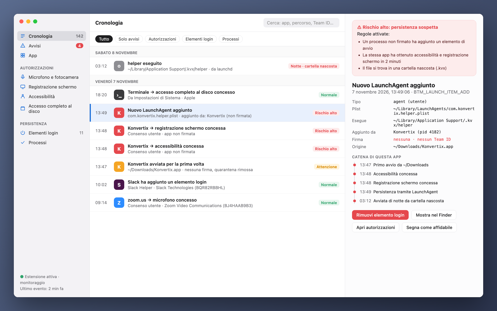
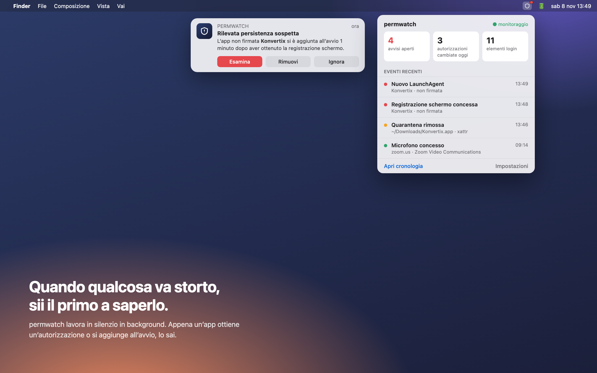
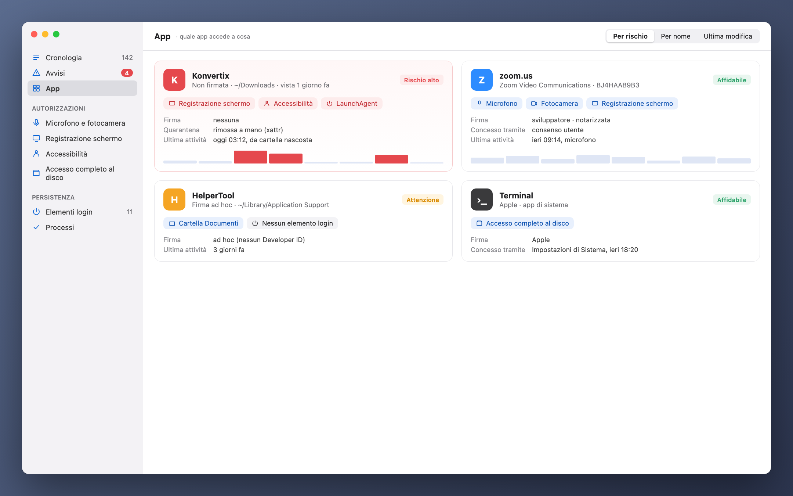

[Türkçe](README_tr.md) · [English](../../README.md) · [Русский](README_ru.md) · [Deutsch](README_de.md) · [Français](README_fr.md) · [Español](README_es.md) · [Português](README_pt.md) · **Italiano** · [Українська](README_uk.md) · [日本語](README_ja.md) · [简体中文](README_zh.md) · [한국어](README_ko.md) · [العربية](README_ar.md)

# permwatch

**Scopri a cosa può accedere ogni app del tuo Mac.**

Fotocamera, microfono, registrazione schermo, elementi di login. 
permwatch registra ogni modifica alle autorizzazioni e ti avvisa appena qualcosa non torna.

---

## Hai autorizzato e dimenticato

"Consenti la registrazione dello schermo." "È richiesto l'accesso ad Accessibilità." "Aprire al login?"

Clicchiamo "OK" decine di volte al giorno. Ma a quale app hai dato quale autorizzazione, e quando?
Quale si è aggiunta in silenzio all'avvio? macOS non ti mostra queste risposte.

**permwatch sì.**

  

## Uno scenario

Scarichi un convertitore PDF gratuito. Lo apri, chiede qualche autorizzazione, clicchi "OK".
Tutto sembra normale.

Nel frattempo, permwatch vede questo in background:

| Ora | Cosa è successo |
|---|---|
| 13:46 | Il **flag di quarantena** dell'app scaricata **è stato rimosso**, aggirando Gatekeeper |
| 13:47 | Un'app **non firmata** è stata avviata per la prima volta da Download |
| 13:48 | In un minuto ha ottenuto **Accessibilità** e **registrazione schermo** |
| 13:49 | Ha **aggiunto all'avvio un programma da una cartella nascosta** |
| 03:12 | Nel cuore della notte, mentre dormivi, **quel programma nascosto è stato eseguito** |

Preso da solo, ogni passo sembra innocuo. Insieme formano una catena d'attacco ben nota.
permwatch unisce i puntini e ti mostra un unico avviso chiaro.

  

## Cosa fa

- 🛡 **Panoramica e controllo con un clic:** un verdetto chiaro all’apertura. «Controlla il Mac» avvia la scansione malware e verifica dirottamento del browser, intercettazione del traffico (certificati radice, profili, proxy, DNS, VPN), perdite della VPN, accesso remoto e combinazioni di permessi tipiche degli spyware. Ogni problema ha un pulsante per risolverlo.
- 🐞 **Scansione malware:** app, elementi di login, programmi in esecuzione e download vengono controllati con **le firme XProtect di Apple** tramite il motore open source YARA. Una scansione rapida richiede circa 10 secondi; i nuovi download vengono analizzati automaticamente.
- 🔐 **Permessi:** cronologia di ogni modifica, permessi rimasti di app eliminate, revoca con un clic, disinstallazione.
- 🌐 **Rete:** quale app si collega dove, cattura pacchetti con nomi dei processi e spiegazioni chiare, blocco dei server con il firewall integrato di macOS.
- ⬇️ **Download, 🎙 microfono e fotocamera, ⌨️ terminale** con comandi di sicurezza pronti.

  

## Cosa non è

permwatch **non è un antivirus completo.** Rileva il malware noto alle firme di Apple, ma non blocca i programmi in tempo reale. Le regole sono euristiche: falsi allarmi e mancate rilevazioni sono possibili.

## La tua privacy resta con te

permwatch **non invia nulla su di te.** Niente analisi, account o cloud. Dettagli: **[PRIVACY.md](../../PRIVACY.md)**

## Come funziona

- Legge il database dei permessi di macOS e gli elementi di login (con accesso completo al disco) e ne osserva i cambiamenti.
- La **modalità amministratore** opzionale si installa come servizio di sistema (SMAppService) dopo una sola approvazione; macOS verifica la firma.
- La cattura pacchetti usa libpcap e PKTAP di Apple (processo per pacchetto).
- Un motore Endpoint Security (C) per eventi in tempo reale è pronto e attende l’autorizzazione di Apple.

## Codice di terze parti

- [YARA](https://github.com/VirusTotal/yara) v4.5.8 (BSD-3-Clause)
- [SwiftTerm](https://github.com/migueldeicaza/SwiftTerm) v1.20.0 (MIT)

## Stato

- ✅ App per macOS in 13 lingue, notarizzata da Apple.
- ⏳ Autorizzazione Endpoint Security di Apple: in revisione.

Sei uno sviluppatore e vuoi provare il motore? **[Guida per sviluppatori (in inglese) →](../GELISTIRME_en.md)**

## ☕ Mi offri un caffè?

permwatch è gratuito e open source, senza pubblicità, account o tracciamento. Se ti è stato utile, una piccola donazione aiuta a mantenerlo. Invia ogni moneta solo sulla rete indicata.

| Moneta | Indirizzo |
|---|---|
| Bitcoin (BTC) · Taproot | `bc1pyuwdr40733dtzkeefj6xu3asnncwa0a67q2q6sw7fuut4zfhx8yqf2ta3l` |
| Bitcoin (BTC) · SegWit | `bc1qevw8l3pwfahysgmxy0vhv2srnk0dcyze7pggq8` |
| Monero (XMR) | `42tsRvBWbPujgVpQdNy6Ba6ovKNcPkxQBKWn1rYcENDpAPTuvQ2ejxCXcUc5KJQTdkHicn4agR7GnYroSUGQLzVhL93KmTt` |
| Ethereum (ERC-20): ETH, USDC, USDT, SHIB, LINK, UNI | `0xCD9ab39db50A830e157776a97bc9Ae21811e3177` |
| Litecoin (LTC) · SegWit | `ltc1qx40ryzy34vf5977aq5uk3rpqm7err5jvf7gcwl` |
| Litecoin (LTC) · Legacy | `LV6kxUc84QoHq7zGZBz1T38vwdcAXQPxR1` |
| Dogecoin (DOGE) | `DTtZ7oJELg9hs43o1g97qVM676H46XorAT` |
| Solana (SOL) | `5uwHKnCMFbFpob2ssypd69svUFCYZQePCwZcQfELckAD` |
| Xelis (XEL) | `xel:h2mt8pc2059rgq3x67xhndqfm8xukrn49zx2la7qmjqnwhgftc4qqasdzay` |
| Banano (BAN) | `ban_1teuphtrxw6rtr7ttr7iaxtaspm11wjqhjh6j84twcp6pcbiyb4cgzth9439` |

---

Fatto da un appassionato di sicurezza macOS, per i curiosi.

