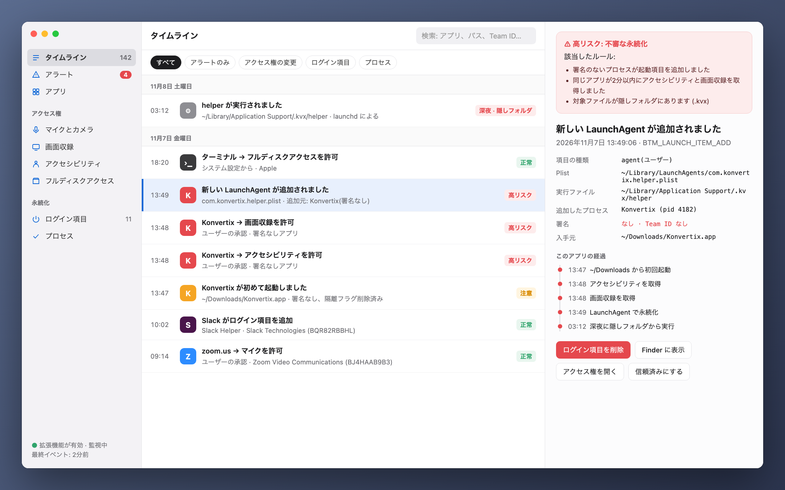
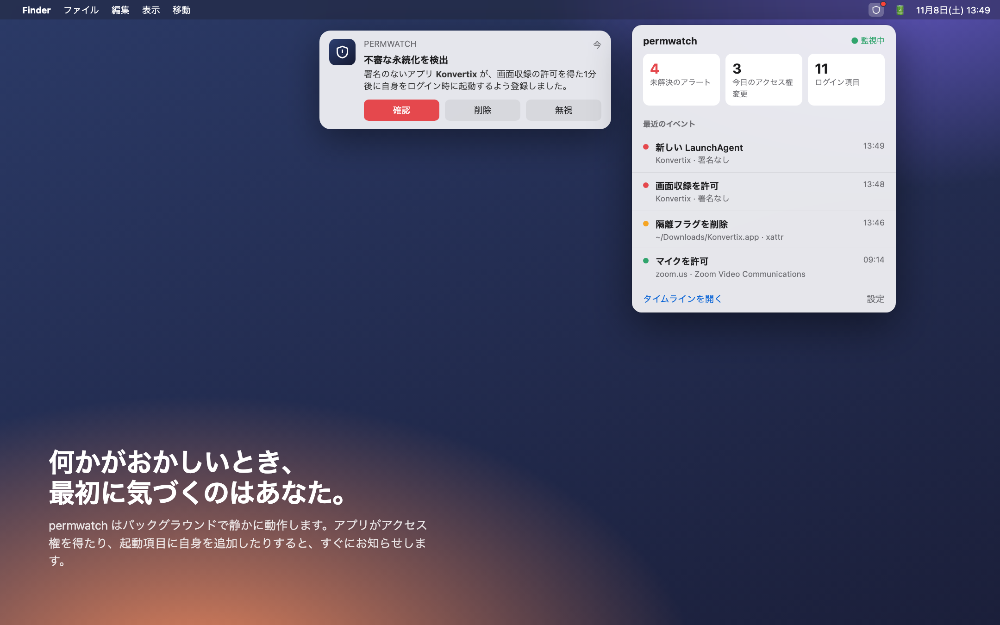
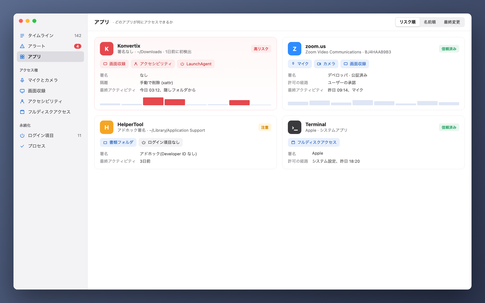

[Türkçe](README_tr.md) · [English](../../README.md) · [Русский](README_ru.md) · [Deutsch](README_de.md) · [Français](README_fr.md) · [Español](README_es.md) · [Português](README_pt.md) · [Italiano](README_it.md) · [Українська](README_uk.md) · **日本語** · [简体中文](README_zh.md) · [한국어](README_ko.md) · [العربية](README_ar.md)

# permwatch

**Mac のアプリが何にアクセスできるのかを、ひと目で。**

カメラ、マイク、画面収録、ログイン項目。 
permwatch はアクセス権の変更をすべて記録し、怪しい動きがあればすぐにお知らせします。

Apple Silicon と Intel · macOS 14 以降 · 無料 
zip を開き、**permwatch** を「アプリケーション」フォルダにドラッグします。

---

## 許可して、忘れてしまう

「画面収録を許可してください」「アクセシビリティへのアクセスが必要です」「ログイン時に開きますか?」

私たちは毎日何十回も「OK」を押しています。でも、どのアプリに、いつ、どんな許可を与えたか覚えていますか?
どのアプリがこっそり起動項目に自分を追加したでしょう? macOS はその答えを見せてくれません。

**permwatch なら見せてくれます。**

  

## ある日のシナリオ

無料の PDF 変換アプリをダウンロードします。開くといくつかの許可を求められ、「OK」を押します。
何も変わったところはないように見えます。

その裏で、permwatch はこんな動きを捉えています。

| 時刻 | 起きたこと |
|---|---|
| 13:46 | ダウンロードしたアプリの**隔離フラグが削除され**、Gatekeeper が回避された |
| 13:47 | **署名のない**アプリがダウンロードフォルダから初めて起動した |
| 13:48 | 1分のうちに**アクセシビリティ**と**画面収録**の両方の許可を得た |
| 13:49 | **隠しフォルダ内のプログラムを起動項目に追加**した |
| 03:12 | 深夜、あなたが眠っている間に**その隠しプログラムが実行された** |

一つひとつは無害に見えても、つなげるとよく知られた攻撃の流れになります。
permwatch はそれらを結びつけ、ひとつのわかりやすいアラートにして伝えます。

  

## できること

- 🛡 **概要とワンクリックチェック:** 起動時にはっきりした判定を表示。「Mac をチェック」でマルウェアスキャンを実行し、ブラウザの乗っ取り、通信の傍受(ルート証明書、プロファイル、プロキシ、DNS、VPN)、VPN リーク、リモートアクセス、スパイウェアに典型的な権限の組み合わせを確認します。各項目に修正ボタンがあります。
- 🐞 **マルウェアスキャン:** アプリ、ログイン項目、実行中のプログラム、ダウンロードを、**Apple の XProtect シグネチャ**と **Elastic Security の公開 macOS マルウェアルール**でチェックします（オープンソースの YARA エンジンを使用）。クイックスキャンは約10秒です。見つかったものは、それを起動するログイン項目ごと隔離できます。実行できなくなり、誤検知なら復元できます。
- 🛡️ **リアルタイム保護:** アプリケーション、ダウンロード、ログイン項目、マルウェアが潜むフォルダの新規・変更ファイルを数秒でスキャンします。書類はランサムウェア（多数のファイルが急に暗号化される）から見張られ、原因のプログラムが未署名なら一時停止します。既知のマルウェアリスト（abuse.ch）にあるサーバーへの接続は警告され、ブロックするかどうかはあなたが決めます。
- 🧭 **シンプルで常に最新：** 短い初回ガイド、多くの人に必要な項目だけを表示するシンプルモード（残りは詳細モード）、進捗バー付きでアプリ内に届くアップデート、技術情報が入力済みのメールを開く **ヘルプ › 問題を報告**。
- 🔐 **権限:** すべての変更履歴、削除済みアプリに残った権限、ワンクリックでの取り消し、アプリの削除。
- 🌐 **ネットワーク:** どのアプリがどこに接続しているか、プロセス名とわかりやすい説明付きのパケットキャプチャ、macOS 内蔵ファイアウォールによるサーバのブロック。
- ⬇️ **ダウンロード、🎙 マイクとカメラ、⌨️ ターミナル**(セキュリティ用コマンド付き)。

  

## できないこと

permwatch は**独自の研究チームを持つ市販のウイルス対策ソフトの代わりにはなりません。**シグネチャは Apple（XProtect）と Elastic Security、サーバーリストは abuse.ch から取得しているため、これらの情報源が把握しているものを検出します。リアルタイム保護はファイルシステムのイベントで動作します。新しいファイルは数秒でスキャンされますが、プログラムを起動*前*に止めることはできません。それには Apple の Endpoint Security 権限が必要で、現在申請中です。既知の悪意あるサーバーへの接続が自動でブロックされることはなく、まず確認を求めます。

ルールはヒューリスティックです。誤検知（開発ツールなど）が起きることも、巧妙に隠れたマルウェアを見逃すこともあります。

## プライバシーはあなたの手元に

permwatch は **あなたに関する情報を送信しません。** 分析もアカウントもクラウドもありません。詳細: **[PRIVACY.md](../../PRIVACY.md)**

## しくみ

- macOS の権限データベースとログイン項目を(フルディスクアクセスで)読み取り、変更を監視します。
- 任意の **管理者モード** は一度承認するだけでシステムサービス(SMAppService)としてインストールされ、署名は macOS が検証します。
- パケットキャプチャは libpcap と Apple の PKTAP(パケットごとのプロセス)を使います。
- リアルタイムイベント用の Endpoint Security エンジン(C)は完成しており、Apple の許可待ちです。

## サードパーティのコード

- [YARA](https://github.com/VirusTotal/yara) v4.5.8 (BSD-3-Clause)
- [SwiftTerm](https://github.com/migueldeicaza/SwiftTerm) v1.20.0 (MIT)

## 現在の状況

- ✅ Apple Silicon と Intel に対応した macOS アプリ：リアルタイム保護と隔離付きのマルウェアスキャン、ランサムウェア対策、悪意あるサーバーの確認、権限、ログイン項目、ブラウザと遠隔操作の確認、ネットワークとパケットキャプチャ。アップデートはアプリ内に届きます。13 言語に対応。
- ⏳ Apple Endpoint Security の許可: 審査中。

デベロッパの方でコアを試してみたい場合は: **[開発者ガイド(英語)→](../GELISTIRME_en.md)**

## ☕ コーヒーをおごってくれませんか？

permwatch は無料のオープンソースで、広告・アカウント・追跡はありません。役に立ったなら、少額の寄付が開発の支えになります。各コインは記載のネットワークでのみ送金してください。

| コイン | アドレス |
|---|---|
| Bitcoin (BTC) · Taproot | `bc1pyuwdr40733dtzkeefj6xu3asnncwa0a67q2q6sw7fuut4zfhx8yqf2ta3l` |
| Bitcoin (BTC) · SegWit | `bc1qevw8l3pwfahysgmxy0vhv2srnk0dcyze7pggq8` |
| Monero (XMR) | `42tsRvBWbPujgVpQdNy6Ba6ovKNcPkxQBKWn1rYcENDpAPTuvQ2ejxCXcUc5KJQTdkHicn4agR7GnYroSUGQLzVhL93KmTt` |
| Ethereum (ERC-20): ETH, USDC, USDT, SHIB, LINK, UNI | `0xCD9ab39db50A830e157776a97bc9Ae21811e3177` |
| Litecoin (LTC) · SegWit | `ltc1qx40ryzy34vf5977aq5uk3rpqm7err5jvf7gcwl` |
| Litecoin (LTC) · Legacy | `LV6kxUc84QoHq7zGZBz1T38vwdcAXQPxR1` |
| Dogecoin (DOGE) | `DTtZ7oJELg9hs43o1g97qVM676H46XorAT` |
| Solana (SOL) | `5uwHKnCMFbFpob2ssypd69svUFCYZQePCwZcQfELckAD` |
| Xelis (XEL) | `xel:h2mt8pc2059rgq3x67xhndqfm8xukrn49zx2la7qmjqnwhgftc4qqasdzay` |
| Banano (BAN) | `ban_1teuphtrxw6rtr7ttr7iaxtaspm11wjqhjh6j84twcp6pcbiyb4cgzth9439` |

---

macOS のセキュリティに興味を持つ人が、同じく好奇心旺盛な人のために作りました。

