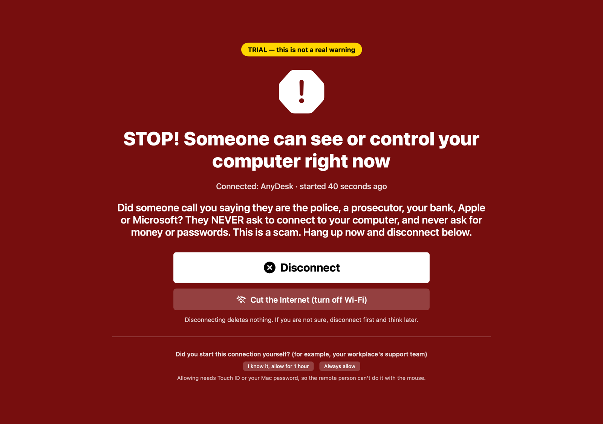
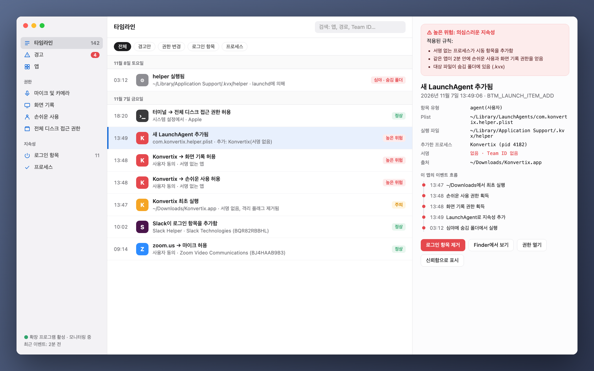
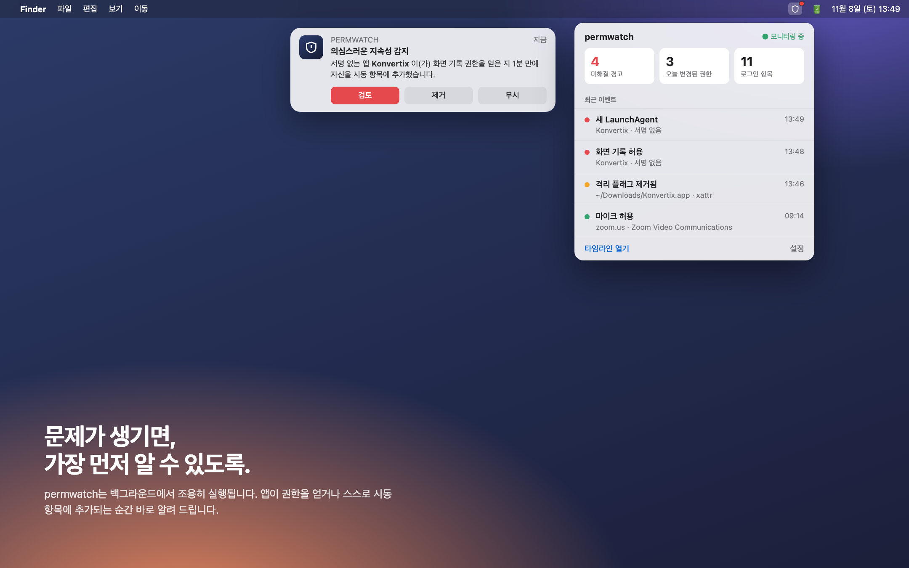
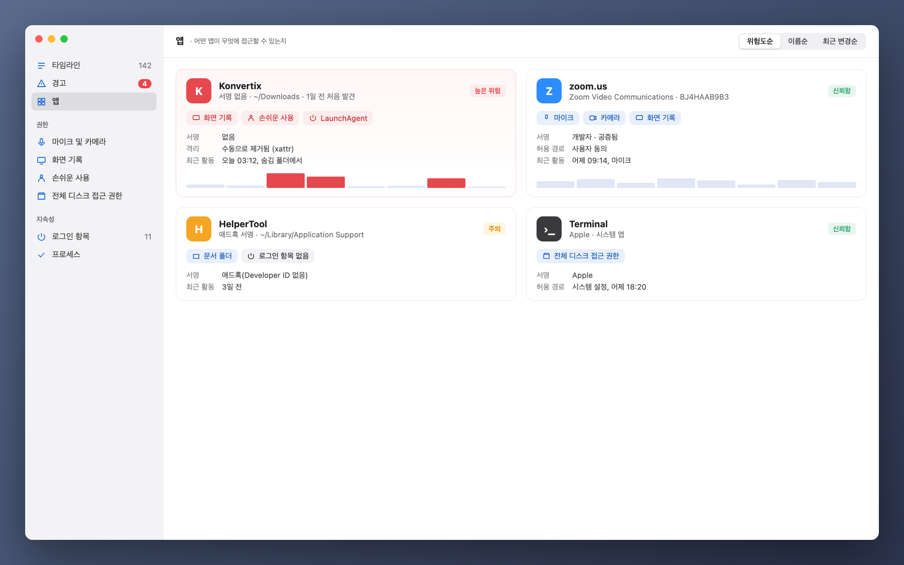

[Türkçe](README_tr.md) · [English](../../README.md) · [Русский](README_ru.md) · [Deutsch](README_de.md) · [Français](README_fr.md) · [Español](README_es.md) · [Português](README_pt.md) · [Italiano](README_it.md) · [Українська](README_uk.md) · [日本語](README_ja.md) · [简体中文](README_zh.md) · **한국어** · [العربية](README_ar.md)

# permwatch

**Mac의 모든 앱이 무엇에 접근할 수 있는지 확인하세요.**

카메라, 마이크, 화면 기록, 로그인 항목. 
permwatch는 모든 권한 변경을 기록하고, 수상한 일이 생기면 바로 알려 줍니다.

Apple Silicon 및 Intel · macOS 14 이상 · 무료 
zip을 열고 **permwatch**를 응용 프로그램 폴더로 드래그하세요.

---

## 📞 전화 사기범을 막습니다

누군가 경찰, 은행, 기술 지원을 사칭해 전화로 AnyDesk 같은 프로그램을 설치하게 합니다. 그리고 당신이 은행에 로그인하는 동안 화면을 봅니다. 이런 프로그램은 악성코드가 아니어서 백신은 막지 못합니다.

**permwatch는 막습니다.** 누군가 원격으로 Mac을 보거나 조종하기 시작하는 순간 전체 화면 경고가 나타나고 소리로도 알립니다. 버튼 하나로 연결을 끊고, 서버를 차단하고, 권한을 해제합니다. 연결 중에 은행 사이트를 열면 더 강하게 경고하고, 이후 해야 할 일을 정확히 알려 줍니다. AnyDesk로 다른 사람을 도와줄 때는 반응하지 않습니다. 당신의 화면이 전송될 때만 반응합니다.

  

## 허용하고, 잊어버렸다

"화면 기록을 허용하십시오." "손쉬운 사용 접근 권한이 필요합니다." "로그인 시 열까요?"

우리는 하루에도 수십 번 "확인"을 누릅니다. 그런데 어떤 앱에 언제 어떤 권한을 줬는지 기억하시나요?
어떤 앱이 조용히 자신을 시동 항목에 추가했을까요? macOS는 그 답을 보여 주지 않습니다.

**permwatch는 보여 줍니다.**

  

## 시나리오

무료 PDF 변환기를 내려받습니다. 열어 보니 몇 가지 권한을 요청하고, "확인"을 누릅니다.
모든 것이 평범해 보입니다.

그동안 permwatch는 백그라운드에서 이런 일을 보고 있습니다.

| 시간 | 일어난 일 |
|---|---|
| 13:46 | 내려받은 앱의 **격리 플래그가 제거되어** Gatekeeper가 우회됨 |
| 13:47 | **서명 없는** 앱이 다운로드 폴더에서 처음 실행됨 |
| 13:48 | 1분 안에 **손쉬운 사용**과 **화면 기록** 권한을 모두 얻음 |
| 13:49 | **숨김 폴더의 프로그램을 시동 항목에 추가**함 |
| 03:12 | 한밤중, 당신이 자는 동안 **그 숨겨진 프로그램이 실행됨** |

하나씩 보면 모두 무해해 보이지만, 함께 보면 익숙한 공격 흐름입니다.
permwatch는 이 점들을 연결해 하나의 명확한 경고로 알려 줍니다.

  

## 기능

- 🛡 **개요와 원클릭 검사:** 실행하면 명확한 판정을 보여 줍니다. '내 Mac 검사'는 악성 코드 검사를 실행하고 브라우저 탈취, 트래픽 가로채기(루트 인증서, 프로파일, 프록시, DNS, VPN), VPN 누출, 원격 접근, 스파이웨어 특유의 권한 조합을 확인합니다. 모든 항목에 수정 버튼이 있습니다.
- 🐞 **악성코드 검사:** 앱, 로그인 항목, 실행 중인 프로그램, 다운로드를 **Apple XProtect 시그니처**와 **Elastic Security의 공개 macOS 악성코드 규칙**으로 검사합니다(오픈 소스 YARA 엔진 사용). 빠른 검사는 약 10초 걸립니다. 발견된 항목은 이를 실행하는 로그인 항목과 함께 격리할 수 있습니다. 더 이상 실행되지 않으며, 오탐이면 복원할 수 있습니다.
- 🛡️ **실시간 보호:** 응용 프로그램, 다운로드, 로그인 항목, 악성코드가 숨는 폴더의 새 파일이나 변경된 파일을 몇 초 안에 검사합니다. 문서를 랜섬웨어(많은 파일이 갑자기 암호화됨)로부터 감시하며, 원인 프로그램이 서명되지 않았다면 일시 정지합니다. 알려진 악성코드 목록(abuse.ch)에 있는 서버로의 연결은 표시되며, 차단 여부는 사용자가 결정합니다.
- 🧭 **간단하고 항상 최신:** 짧은 시작 안내, 대부분에게 필요한 항목만 보여 주는 간단 모드(나머지는 고급 모드), 진행 막대와 함께 앱 안에서 받는 업데이트, 기술 정보가 미리 채워진 메일을 여는 **도움말 › 문제 신고**.
- 🔐 **권한:** 모든 변경 기록, 삭제된 앱에 남은 권한, 원클릭 취소, 앱 제거.
- 🌐 **네트워크:** 어떤 앱이 어디에 연결하는지, 프로세스 이름과 쉬운 설명이 붙은 패킷 캡처, macOS 내장 방화벽으로 서버 차단.
- ⬇️ **다운로드, 🎙 마이크와 카메라, ⌨️ 터미널**(보안 명령 포함).

  

## 이것이 아닌 것

permwatch는 **자체 연구팀을 갖춘 상용 백신을 대체하지 않습니다.** 시그니처는 Apple(XProtect)과 Elastic Security에서, 서버 목록은 abuse.ch에서 가져오므로 이 출처들이 아는 것을 찾아냅니다. 실시간 보호는 파일 시스템 이벤트로 작동합니다. 새 파일은 몇 초 안에 검사되지만 프로그램을 시작*되기 전에* 막을 수는 없습니다. 그러려면 Apple의 Endpoint Security 권한이 필요하며 현재 신청해 두었습니다. 알려진 악성 서버로의 연결은 절대 자동으로 차단되지 않으며, 먼저 묻습니다.

규칙은 휴리스틱입니다. 오탐(예: 개발자 도구)이 생길 수 있고, 잘 숨겨진 악성코드를 놓칠 수 있습니다.

## 개인정보는 내 Mac에

permwatch는 **사용자에 관한 어떤 정보도 보내지 않습니다.** 분석, 계정, 클라우드가 없습니다. 자세히: **[PRIVACY.md](../../PRIVACY.md)**

## 작동 방식

- macOS 권한 데이터베이스와 로그인 항목을 (전체 디스크 접근 권한으로) 읽고 변경을 감시합니다.
- 선택 사항인 **관리자 모드**는 한 번 승인하면 시스템 서비스(SMAppService)로 설치되며 서명은 macOS가 확인합니다.
- 패킷 캡처는 libpcap과 Apple PKTAP(패킷별 프로세스)를 사용합니다.
- 실시간 이벤트용 Endpoint Security 엔진(C)이 준비되어 Apple의 승인을 기다리고 있습니다.

## 서드파티 코드

- [YARA](https://github.com/VirusTotal/yara) v4.5.8 (BSD-3-Clause)
- [SwiftTerm](https://github.com/migueldeicaza/SwiftTerm) v1.20.0 (MIT)

## 상태

- ✅ Apple Silicon 및 Intel용 macOS 앱: 실시간 보호와 격리를 갖춘 악성코드 검사, 랜섬웨어 보호, 악성 서버 확인, 권한, 로그인 항목, 브라우저 및 원격 접속 확인, 네트워크와 패킷 캡처. 업데이트는 앱 안에서 받습니다. 13개 언어 지원.
- ⏳ Apple Endpoint Security 권한: 검토 중.

개발자이고 핵심 엔진을 써 보고 싶다면: **[개발자 가이드(영어) →](../GELISTIRME_en.md)**

## ☕ 커피 한 잔 사주실래요?

permwatch는 무료 오픈 소스이며 광고, 계정, 추적이 없습니다. 도움이 되었다면 작은 후원이 개발을 이어가게 합니다. 각 코인은 표시된 네트워크로만 보내 주세요.

| 코인 | 주소 |
|---|---|
| Bitcoin (BTC) · Taproot | `bc1pyuwdr40733dtzkeefj6xu3asnncwa0a67q2q6sw7fuut4zfhx8yqf2ta3l` |
| Bitcoin (BTC) · SegWit | `bc1qevw8l3pwfahysgmxy0vhv2srnk0dcyze7pggq8` |
| Monero (XMR) | `42tsRvBWbPujgVpQdNy6Ba6ovKNcPkxQBKWn1rYcENDpAPTuvQ2ejxCXcUc5KJQTdkHicn4agR7GnYroSUGQLzVhL93KmTt` |
| Ethereum (ERC-20): ETH, USDC, USDT, SHIB, LINK, UNI | `0xCD9ab39db50A830e157776a97bc9Ae21811e3177` |
| Litecoin (LTC) · SegWit | `ltc1qx40ryzy34vf5977aq5uk3rpqm7err5jvf7gcwl` |
| Litecoin (LTC) · Legacy | `LV6kxUc84QoHq7zGZBz1T38vwdcAXQPxR1` |
| Dogecoin (DOGE) | `DTtZ7oJELg9hs43o1g97qVM676H46XorAT` |
| Solana (SOL) | `5uwHKnCMFbFpob2ssypd69svUFCYZQePCwZcQfELckAD` |
| Xelis (XEL) | `xel:h2mt8pc2059rgq3x67xhndqfm8xukrn49zx2la7qmjqnwhgftc4qqasdzay` |
| Banano (BAN) | `ban_1teuphtrxw6rtr7ttr7iaxtaspm11wjqhjh6j84twcp6pcbiyb4cgzth9439` |

---

macOS 보안에 호기심 많은 사람이, 같은 호기심을 가진 이들을 위해 만들었습니다.

