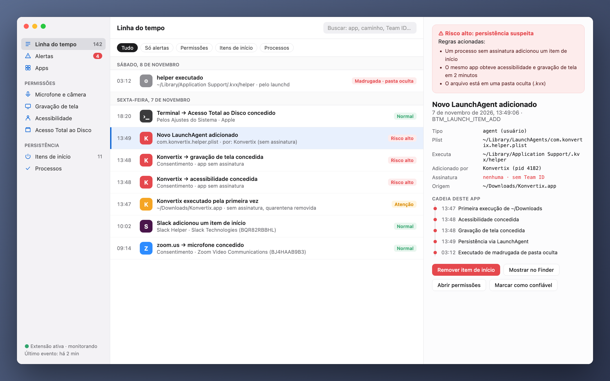
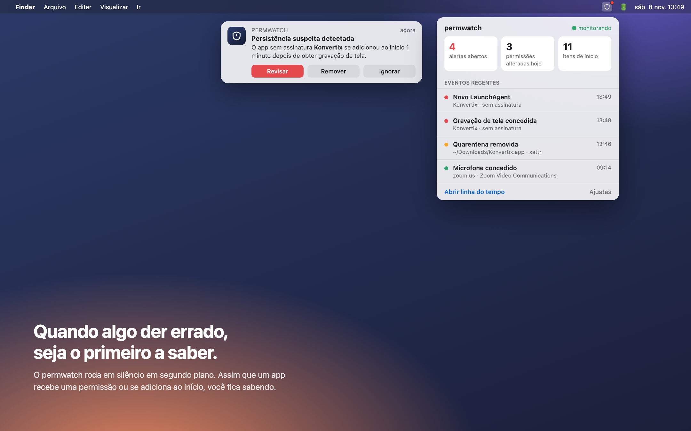
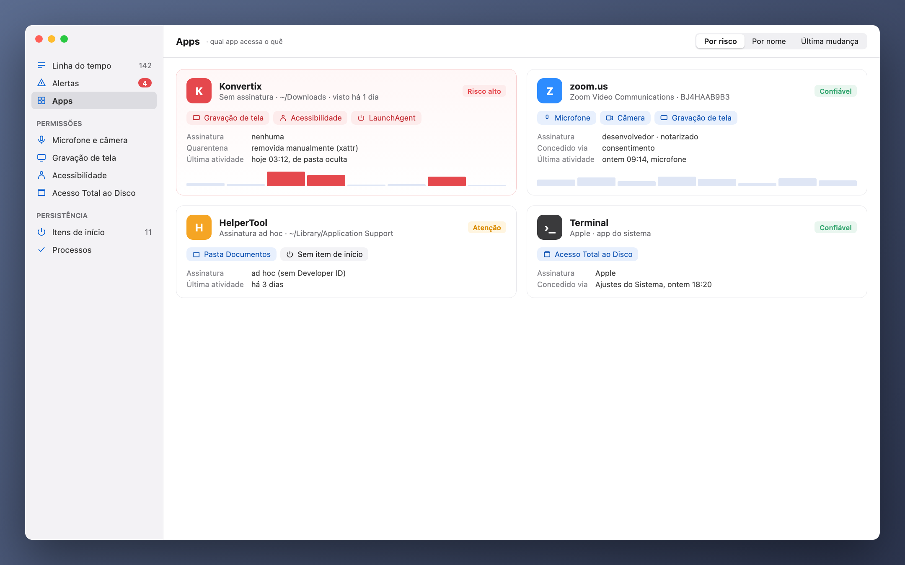

[Türkçe](README_tr.md) · [English](../../README.md) · [Русский](README_ru.md) · [Deutsch](README_de.md) · [Français](README_fr.md) · [Español](README_es.md) · **Português** · [Italiano](README_it.md) · [Українська](README_uk.md) · [日本語](README_ja.md) · [简体中文](README_zh.md) · [한국어](README_ko.md) · [العربية](README_ar.md)

# permwatch

**Veja o que cada app do seu Mac pode acessar.**

Câmera, microfone, gravação de tela, itens de início. 
O permwatch registra cada mudança de permissão e avisa você assim que algo parecer estranho.

Apple Silicon (M1 ou posterior) · macOS 14 ou posterior · grátis 
Abra o zip e arraste o **permwatch** para a pasta Aplicativos.

---

## Você permitiu e esqueceu

"Permitir gravação de tela." "Acesso de acessibilidade necessário." "Abrir ao iniciar sessão?"

Clicamos em "OK" dezenas de vezes por dia. Mas qual app recebeu qual permissão, e quando?
Qual delas se adicionou em silêncio ao início? O macOS não mostra essas respostas.

**O permwatch mostra.**

  

## Um cenário

Você baixa um conversor de PDF gratuito. Abre, ele pede algumas permissões, você clica em "OK".
Tudo parece normal.

Enquanto isso, o permwatch vê o seguinte em segundo plano:

| Hora | O que aconteceu |
|---|---|
| 13:46 | A **marca de quarentena** do app baixado **foi removida**, contornando o Gatekeeper |
| 13:47 | Um app **sem assinatura** foi executado pela primeira vez a partir de Downloads |
| 13:48 | Em um minuto ele obteve **acessibilidade** e **gravação de tela** |
| 13:49 | Ele **adicionou ao início um programa de uma pasta oculta** |
| 03:12 | De madrugada, enquanto você dormia, **esse programa oculto foi executado** |

Cada passo, sozinho, parece inofensivo. Juntos, formam uma cadeia de ataque conhecida.
O permwatch liga os pontos e mostra um único alerta claro.

  

## O que ele faz

- 🛡 **Visão geral e verificação com um clique:** um veredito claro ao abrir. “Verificar meu Mac” faz a verificação de malware e checa sequestro do navegador, interceptação de tráfego (certificados raiz, perfis, proxy, DNS, VPN), vazamentos de VPN, acesso remoto e combinações de permissões típicas de spyware. Cada achado tem um botão de correção.
- 🐞 **Verificação de malware:** apps, itens de início, programas em execução e downloads são verificados com **as próprias assinaturas XProtect da Apple** pelo mecanismo de código aberto YARA. Uma verificação rápida leva cerca de 10 segundos; novos downloads são verificados automaticamente.
- 🔐 **Permissões:** histórico de cada mudança, permissões que sobraram de apps apagados, revogar com um clique, desinstalar apps.
- 🌐 **Rede:** qual app se conecta aonde, captura de pacotes com nomes de processo e explicações claras, bloqueio de servidores pelo firewall integrado do macOS.
- ⬇️ **Downloads, 🎙 microfone e câmera, ⌨️ terminal** com comandos de segurança prontos.

  

## O que ele não é

O permwatch **não é um antivírus completo.** Ele detecta o malware conhecido pelas assinaturas da Apple, mas não bloqueia programas em tempo real. As regras são heurísticas: alarmes falsos e falhas são possíveis.

## Sua privacidade fica com você

O permwatch **não envia nada sobre você.** Sem análises, sem conta, sem nuvem. Detalhes: **[PRIVACY.md](../../PRIVACY.md)**

## Como funciona

- Lê o banco de permissões do macOS e os itens de início (com Acesso Total ao Disco) e acompanha as mudanças.
- O **modo administrador** opcional é instalado como serviço do sistema (SMAppService) após uma única aprovação; o macOS verifica a assinatura.
- A captura de pacotes usa libpcap e o PKTAP da Apple (processo por pacote).
- Um mecanismo Endpoint Security (C) para eventos em tempo real está pronto e aguarda a autorização da Apple.

## Código de terceiros

- [YARA](https://github.com/VirusTotal/yara) v4.5.8 (BSD-3-Clause)
- [SwiftTerm](https://github.com/migueldeicaza/SwiftTerm) v1.20.0 (MIT)

## Status

- ✅ App para macOS em 13 idiomas, notarizado pela Apple.
- ⏳ Autorização Endpoint Security da Apple: em análise.

É desenvolvedor e quer testar o núcleo? **[Guia do desenvolvedor (em inglês) →](../GELISTIRME_en.md)**

## ☕ Me paga um café?

O permwatch é gratuito e de código aberto, sem anúncios, contas ou rastreamento. Se ele te ajudou, uma pequena doação ajuda a mantê-lo. Envie cada moeda apenas pela rede indicada.

| Moeda | Endereço |
|---|---|
| Bitcoin (BTC) · Taproot | `bc1pyuwdr40733dtzkeefj6xu3asnncwa0a67q2q6sw7fuut4zfhx8yqf2ta3l` |
| Bitcoin (BTC) · SegWit | `bc1qevw8l3pwfahysgmxy0vhv2srnk0dcyze7pggq8` |
| Monero (XMR) | `42tsRvBWbPujgVpQdNy6Ba6ovKNcPkxQBKWn1rYcENDpAPTuvQ2ejxCXcUc5KJQTdkHicn4agR7GnYroSUGQLzVhL93KmTt` |
| Ethereum (ERC-20): ETH, USDC, USDT, SHIB, LINK, UNI | `0xCD9ab39db50A830e157776a97bc9Ae21811e3177` |
| Litecoin (LTC) · SegWit | `ltc1qx40ryzy34vf5977aq5uk3rpqm7err5jvf7gcwl` |
| Litecoin (LTC) · Legacy | `LV6kxUc84QoHq7zGZBz1T38vwdcAXQPxR1` |
| Dogecoin (DOGE) | `DTtZ7oJELg9hs43o1g97qVM676H46XorAT` |
| Solana (SOL) | `5uwHKnCMFbFpob2ssypd69svUFCYZQePCwZcQfELckAD` |
| Xelis (XEL) | `xel:h2mt8pc2059rgq3x67xhndqfm8xukrn49zx2la7qmjqnwhgftc4qqasdzay` |
| Banano (BAN) | `ban_1teuphtrxw6rtr7ttr7iaxtaspm11wjqhjh6j84twcp6pcbiyb4cgzth9439` |

---

Feito por alguém curioso sobre segurança no macOS, para os curiosos.

