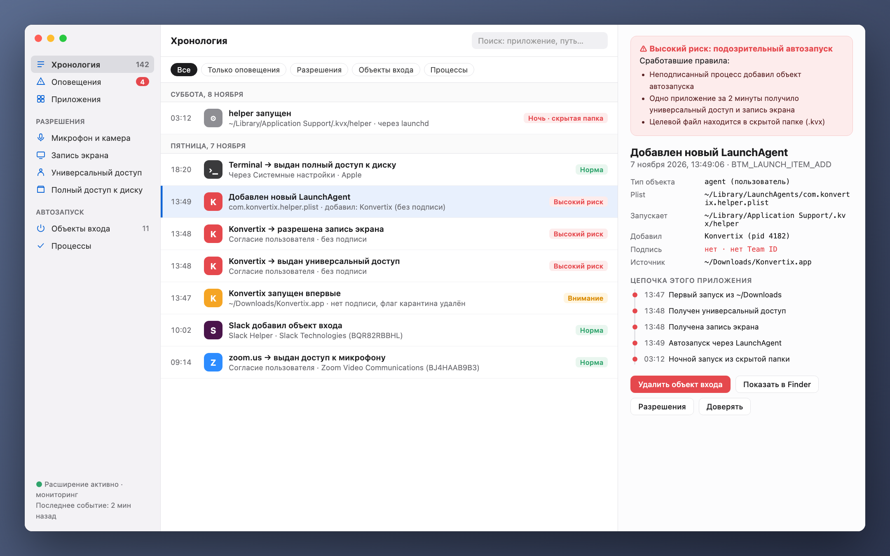
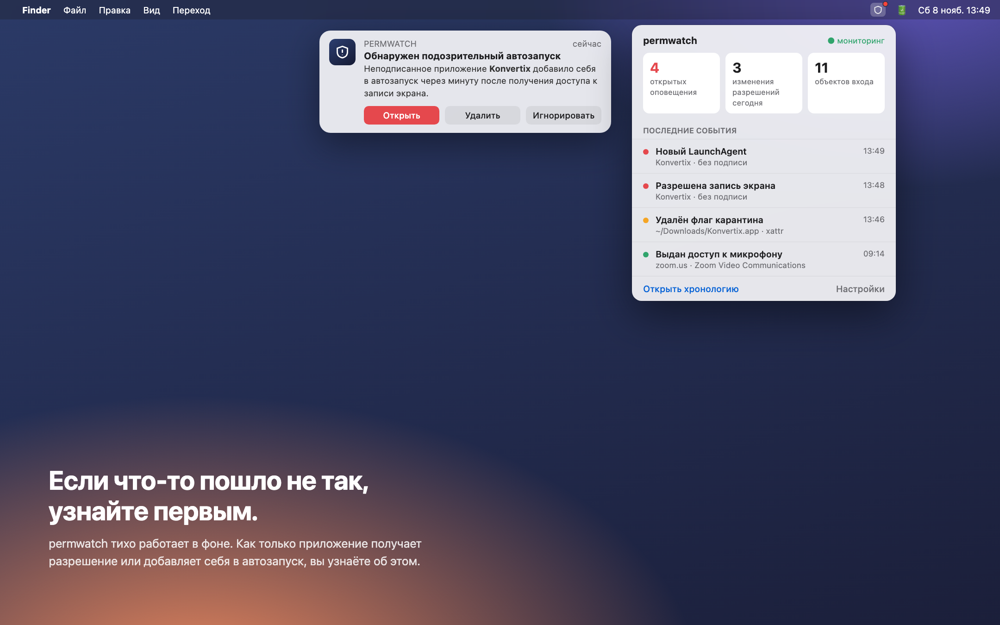
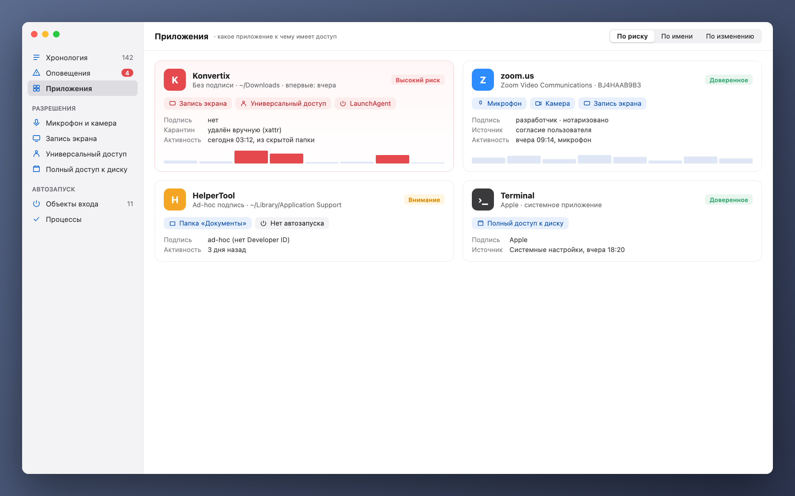

[Türkçe](README_tr.md) · [English](../../README.md) · **Русский** · [Deutsch](README_de.md) · [Français](README_fr.md) · [Español](README_es.md) · [Português](README_pt.md) · [Italiano](README_it.md) · [Українська](README_uk.md) · [日本語](README_ja.md) · [简体中文](README_zh.md) · [한국어](README_ko.md) · [العربية](README_ar.md)

# permwatch

**Узнайте, к чему имеет доступ каждое приложение на вашем Mac.**

Камера, микрофон, запись экрана, объекты автозапуска. 
permwatch ведёт журнал всех изменений разрешений и сразу предупреждает о подозрительных.

---

## Разрешили и забыли

«Разрешить запись экрана». «Требуется универсальный доступ». «Открывать при входе?»

Мы нажимаем «ОК» десятки раз в день. Но какому приложению и когда вы дали какое разрешение?
Какое из них тихо добавило себя в автозапуск? macOS не показывает ответы на эти вопросы.

**permwatch показывает.**

  

## Сценарий

Вы скачиваете бесплатный конвертер PDF. Открываете его, он просит несколько разрешений, вы нажимаете «ОК».
Всё выглядит как обычно.

А permwatch в это время видит следующее:

| Время | Что произошло |
|---|---|
| 13:46 | У скачанного приложения **удалён флаг карантина**, то есть Gatekeeper обойдён |
| 13:47 | **Неподписанное** приложение впервые запущено из «Загрузок» |
| 13:48 | За минуту оно получило и **универсальный доступ**, и **запись экрана** |
| 13:49 | Оно **добавило в автозапуск программу из скрытой папки** |
| 03:12 | Ночью, пока вы спали, **эта скрытая программа запустилась** |

По отдельности каждый шаг выглядит безобидно. Вместе они складываются в знакомую цепочку атаки.
permwatch связывает их и показывает одно понятное оповещение.

  

## Возможности

- 🕒 **Хронология:** каждое изменение разрешений и каждый новый объект автозапуска, с датой и ответственным процессом
- 🚨 **Умные оповещения:** неподписанные приложения, ночная активность, попытки обойти Gatekeeper
- 🔍 **Карточка приложения:** все разрешения приложения в одном месте
- 🧬 **Проверка подписи:** Apple, известный разработчик или неизвестный источник?
- 📍 **В строке меню:** не мешает, но вовремя предупреждает

  

## Ваша приватность остаётся с вами

permwatch **никуда не отправляет данные.** Никакой аналитики, аккаунтов или облака.
Все записи хранятся только на вашем Mac. От инструмента для приватности иного и не ждёшь.

## Как это работает

permwatch использует **Endpoint Security**, официальный фреймворк Apple для программ безопасности.
Ядро написано на C. Оно только **наблюдает** и никогда не вмешивается в работу системы.

## Статус

permwatch находится в активной разработке.

- ✅ Ядро, которое перехватывает события (командная строка)
- ⏳ Разрешение Apple на Endpoint Security: заявка подана, на рассмотрении
- 🛠 Приложение для macOS и интерфейс: на этапе дизайна

> Изображения выше — предварительный дизайн. Приложение «Konvertix» в сценарии вымышленное.

Разработчик и хотите попробовать ядро? **[Руководство для разработчиков →](../GELISTIRME_ru.md)**

---

Сделано человеком, которому интересна безопасность macOS, для таких же любопытных.

