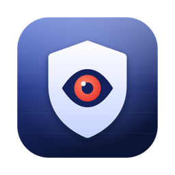
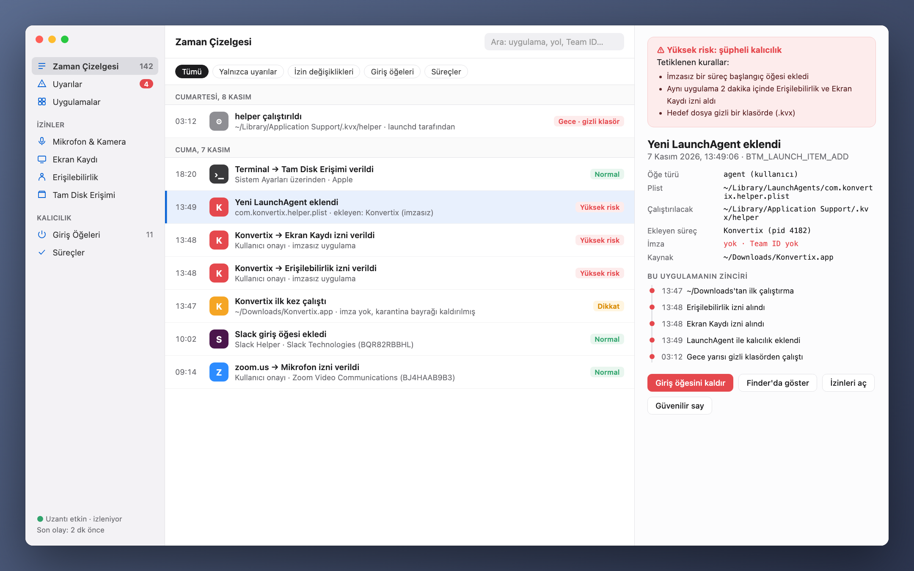
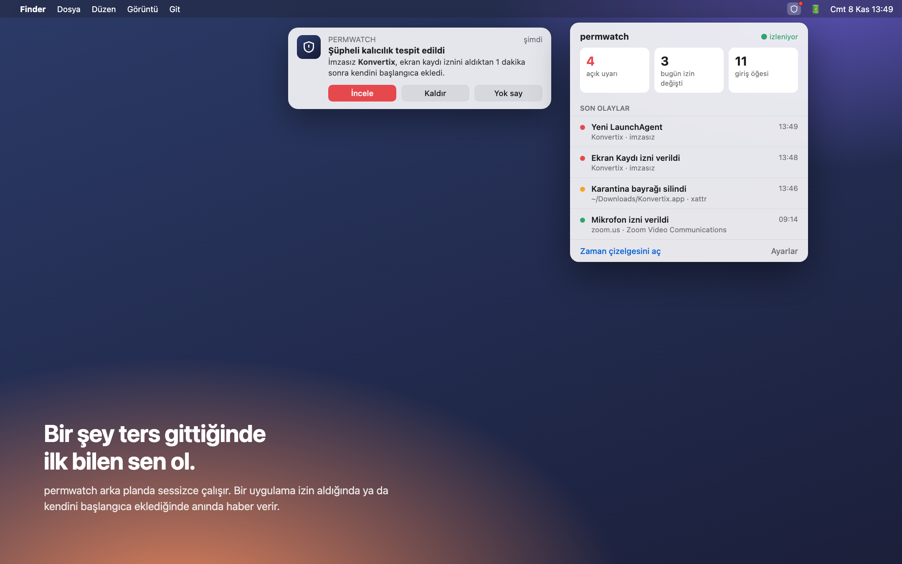
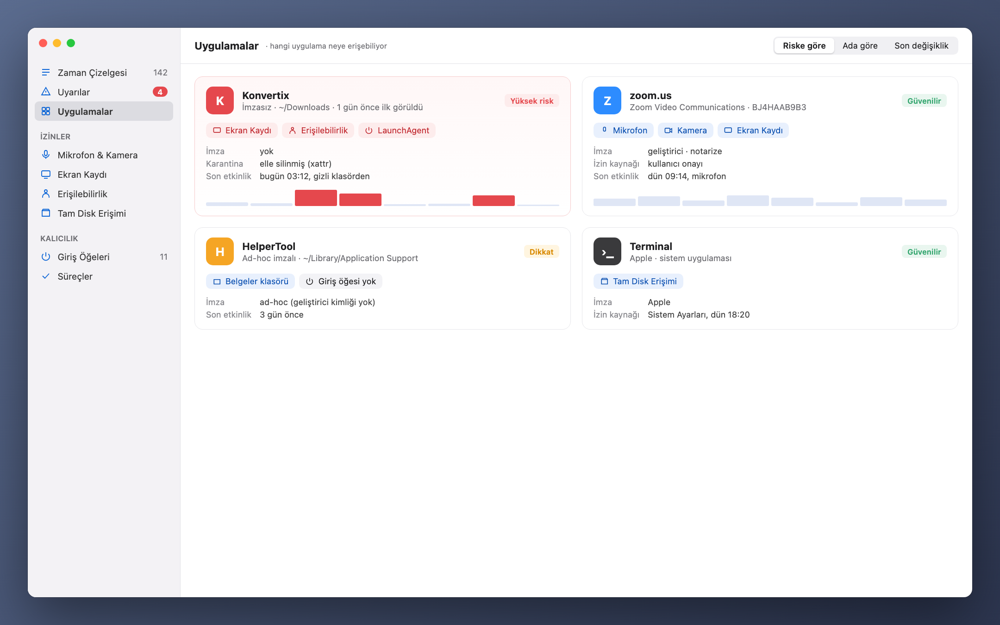

**Türkçe** · [English](../../README.md) · [Русский](README_ru.md) · [Deutsch](README_de.md) · [Français](README_fr.md) · [Español](README_es.md) · [Português](README_pt.md) · [Italiano](README_it.md) · [Українська](README_uk.md) · [日本語](README_ja.md) · [简体中文](README_zh.md) · [한국어](README_ko.md) · [العربية](README_ar.md)

# permwatch

**Mac'inde hangi uygulamanın neye eriştiğini gör.**

Kamera, mikrofon, ekran kaydı, başlangıç öğeleri. 
Her izin değişikliğinin kaydını tutar, şüpheli olanları anında haber verir.

---

## İzin verdin ve unuttun

"Ekran kaydına izin ver." "Erişilebilirlik izni gerekiyor." "Girişte açılsın mı?"

Her gün onlarca kez "Tamam"a basıyoruz. Peki hangi uygulamaya ne zaman ne izni verdin?
Hangisi kendini sessizce başlangıca ekledi? macOS bu soruların cevabını sana göstermiyor.

**permwatch gösteriyor.**

  

## Bir senaryo

İnternetten ücretsiz bir PDF dönüştürücü indiriyorsun. Açıyorsun, birkaç izin istiyor, "Tamam" diyorsun.
Her şey normal görünüyor.

permwatch ise arka planda şunları görüyor:

| Saat | Ne oldu |
|---|---|
| 13:46 | İndirilen uygulamanın **karantina etiketi silindi**, yani Gatekeeper atlatıldı |
| 13:47 | **İmzasız** bir uygulama İndirilenler'den ilk kez çalıştı |
| 13:48 | Bir dakika içinde hem **Erişilebilirlik** hem **Ekran Kaydı** izni aldı |
| 13:49 | Gizli bir klasördeki bir programı **başlangıca ekledi** |
| 03:12 | Gece yarısı, sen uyurken **o gizli program çalıştı** |

Tek tek bakınca masum görünen bu adımlar, birlikte bakınca tanıdık bir saldırı zinciri oluşturuyor.
permwatch zinciri birleştirir ve sana tek bir net uyarı gösterir.

  

## Neler yapar

- 🐞 **Zararlı taraması:** Uygulamalarını, başlangıç öğelerini, çalışan programları ve indirilenleri **Apple'ın kendi XProtect zararlı imzalarıyla** (macOS'un güncel tuttuğu imzalar) açık kaynak YARA motoru kullanarak tarar. Hızlı tarama yaklaşık 10 saniye sürer. Yeni indirilenler otomatik taranır; bulunan zararlı, onu başlatan başlangıç öğeleriyle birlikte Çöp Sepeti'ne taşınabilir.
- 🛡 **Genel bakış ve tek tıkla kontrol:** Açılışta net bir hüküm verir. "Mac'imi Kontrol Et" zararlı taramasını yapar ve şunları denetler: tarayıcı ele geçirme (her siteyi okuyabilen uzantılar, zorla uygulanan tarayıcı politikaları, değiştirilmiş arama motoru veya başlangıç sayfası), araya girme (güvenilen kök sertifikalar, yapılandırma profilleri, proxy, bilinmeyen DNS, VPN yapılandırmaları), uzaktan erişim (Ekran Paylaşımı, SSH, TeamViewer/AnyDesk/ToDesk benzeri araçlar) ve casus yazılımı andıran izin kombinasyonları. Her bulgunun bir düzeltme düğmesi vardır.
- 💡 **Öneriler:** Bütün bulguları sade dille açıklayan ve tek tıkla düzeltme sunan tek ekran. Silinmiş uygulamalardan kalan izinleri ve aylardır açmadığın uygulamalardaki izinleri bulur.
- 🕒 **Zaman çizelgesi:** Her izin değişikliği ve her yeni başlangıç öğesi; tarihi ve sorumlu süreciyle
- 🚨 **Uyarılar:** İmzasız başlangıç programları, şüpheli izin örüntüleri ve Gatekeeper atlatma girişimleri. Yeni bir şey olduğunda ekranın üstünde küçük bir pencere açılır.
- 🔍 **Uygulamalar:** Bir uygulamanın sahip olduğu bütün izinler tek kartta. İzni kaldırabilir veya uygulamayı Çöp Sepeti'ne taşıyabilirsin.
- 🧠 **Çalışan uygulamalar:** Garip yerlerden çalışan, sistem süreci gibi görünen veya dosyası silinmiş programları işaretleyen görev yöneticisi
- 🌐 **Ağ:** Hangi uygulama nereye bağlı; imzasız programlar için uyarı
- 📦 **Paket yakalama:** Wireshark gibi, ama her pakette onu gönderen uygulama ve sade dilde bir açıklama var. İzleyicileri, şifresiz bağlantıları ve açık metin gönderilen parolaları yakalar. Kayıtlar Wireshark'ta açılabilen .pcap dosyaları olarak saklanır.
- ⬇️ **İndirilenler:** Mac'inin her yerindeki (USB diskler dahil) indirilmiş uygulama ve kurulum dosyalarını Gatekeeper ile denetler
- 🎙 **Mikrofon ve kamera:** Şu an kim kullanıyor, geçmişiyle birlikte
- ⌨️ **Terminal:** Uygulamanın içinde gerçek bir terminal (sekmeler, renkler, tam ekran programlar) ve hazır güvenlik komutları menüsü

  

## Ne değildir

permwatch **tam bir antivirüs değildir.** Apple'ın imzalarının bildiği zararlıları bulur ama kendi imza veritabanı yoktur ve **hiçbir şeyi anlık olarak engellemez.** Olanı gösterir, açıklar ve düzeltmene yardım eder. Bağlantıları engellemek istiyorsan yanında LuLu veya Little Snitch gibi bir güvenlik duvarı kullan.

Kurallar sezgiseldir: yanlış alarm verebilir (ör. geliştirici araçlarında) ve iyi gizlenmiş zararlıları kaçırabilir.

## Gizliliğin sende kalır

permwatch **hiçbir yere veri göndermez.** Analiz yok, hesap yok, bulut yok. Ayrıntılar: **[PRIVACY.md](../../PRIVACY.md)**

## Nasıl çalışır

- macOS'un izin veritabanını ve başlangıç öğelerini okur (Tam Disk Erişimi ile) ve değişiklikleri izler
- İsteğe bağlı **yönetici modu**, küçük ve salt-okunur bir yardımcıyı root olarak çalıştırır. Yardımcı başlamadan önce `/Library/PrivilegedHelperTools`'a kopyalanır ve kod imzası geliştiricinin Team ID'sine göre doğrulanır.
- Paket yakalama libpcap kullanır. Yönetici modunda Apple'ın PKTAP'ını kullanır; bu, her pakete onu gönderen süreci ekler.
- Gerçek zamanlı olaylar için Endpoint Security motoru (C) hazır ve Apple'ın iznini bekliyor.

## Üçüncü taraf kod

- Apple'ın XProtect imzalarını çalıştırmak için VirusTotal'ın [YARA](https://github.com/VirusTotal/yara) v4.5.8 motoru (BSD-3). `app/vendor/yara` içinde.
- Terminal için Miguel de Icaza'nın [SwiftTerm](https://github.com/migueldeicaza/SwiftTerm) v1.20.0 kütüphanesi (MIT). `app/vendor/SwiftTerm` içinde.

## Durum

- ✅ macOS uygulaması: izinler, başlangıç öğeleri, süreçler, ağ, paket yakalama, indirilenler, öneriler. 13 dilde kullanılabilir.
- ⏳ Apple Endpoint Security izni: başvuruldu, inceleniyor
- ⏳ Notarize edilmiş sürüm: hazırlanıyor

Geliştiriciysen ve çekirdeği denemek istiyorsan: **[Geliştirici rehberi →](../GELISTIRME.md)**

---

macOS güvenliğini merak eden biri tarafından, meraklılar için yapıldı.

