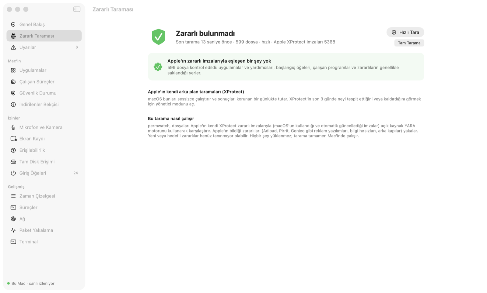

**Türkçe** · [English](../../README.md) · [Русский](README_ru.md) · [Deutsch](README_de.md) · [Français](README_fr.md) · [Español](README_es.md) · [Português](README_pt.md) · [Italiano](README_it.md) · [Українська](README_uk.md) · [日本語](README_ja.md) · [简体中文](README_zh.md) · [한국어](README_ko.md) · [العربية](README_ar.md)

# permwatch

**Mac'inde hangi uygulamanın neye eriştiğini gör.**

Kamera, mikrofon, ekran kaydı, başlangıç öğeleri. 
Her izin değişikliğinin kaydını tutar, şüpheli olanları anında haber verir.

Apple Silicon ve Intel · macOS 14 ve sonrası · ücretsiz 
Zip'i aç ve **permwatch**'ı Uygulamalar klasörüne sürükle.

---

## İzin verdin ve unuttun

"Ekran kaydına izin ver." "Erişilebilirlik izni gerekiyor." "Girişte açılsın mı?"

Her gün onlarca kez "Tamam"a basıyoruz. Peki hangi uygulamaya ne zaman ne izni verdin?
Hangisi kendini sessizce başlangıca ekledi? macOS bu soruların cevabını sana göstermiyor.

**permwatch gösteriyor.**

  

## Bir senaryo

İnternetten ücretsiz bir PDF dönüştürücü indiriyorsun. Açıyorsun, birkaç izin istiyor, "Tamam" diyorsun.
Her şey normal görünüyor.

permwatch ise arka planda şunları görüyor:

| Saat | Ne oldu |
|---|---|
| 13:46 | İndirilen uygulamanın **karantina etiketi silindi**, yani Gatekeeper atlatıldı |
| 13:47 | **İmzasız** bir uygulama İndirilenler'den ilk kez çalıştı |
| 13:48 | Bir dakika içinde hem **Erişilebilirlik** hem **Ekran Kaydı** izni aldı |
| 13:49 | Gizli bir klasördeki bir programı **başlangıca ekledi** |
| 03:12 | Gece yarısı, sen uyurken **o gizli program çalıştı** |

Tek tek bakınca masum görünen bu adımlar, birlikte bakınca tanıdık bir saldırı zinciri oluşturuyor.
permwatch zinciri birleştirir ve sana tek bir net uyarı gösterir.

  

## Neler yapar

- 🐞 **Zararlı taraması:** Uygulamalarını, başlangıç öğelerini, çalışan programları ve indirilenleri **Apple'ın XProtect imzaları** ve **Elastic Security'nin açık macOS zararlı kurallarıyla**, açık kaynak YARA motoru kullanarak tarar. Hızlı tarama yaklaşık 10 saniye sürer. Bulunan zararlı, onu başlatan başlangıç öğeleriyle birlikte karantinaya alınabilir: artık çalışamaz, yanlış alarmsa geri yüklenebilir.
- 🛡️ **Gerçek zamanlı koruma:** Uygulamalar, İndirilenler, başlangıç öğeleri ve zararlıların saklandığı klasörlerdeki yeni ya da değişen dosyalar saniyeler içinde taranır. Belgelerin fidye yazılımına karşı izlenir (çok sayıda dosyanın birden şifrelenmesi); sorumlu program imzasızsa askıya alınır. Bilinen zararlı listelerindeki (abuse.ch) sunuculara giden bağlantılar işaretlenir; engelleyip engellememeye sen karar verirsin.
- 🧭 **Sade ve güncel:** kısa bir ilk açılış rehberi, yalnızca çoğu kişinin ihtiyaç duyduğu bölümleri gösteren basit mod (gerisi için Gelişmiş mod), uygulamanın içinde ilerleme çubuğuyla gelen güncellemeler ve teknik bilgileri hazır doldurulmuş bir e-posta açan **Yardım › Bize Bildir**.
- 🛡 **Genel bakış ve tek tıkla kontrol:** Açılışta net bir hüküm verir. "Mac'imi Kontrol Et" zararlı taramasını yapar ve şunları denetler: tarayıcı ele geçirme (her siteyi okuyabilen uzantılar, zorla uygulanan tarayıcı politikaları, değiştirilmiş arama motoru veya başlangıç sayfası), araya girme (güvenilen kök sertifikalar, yapılandırma profilleri, proxy, bilinmeyen DNS, VPN yapılandırmaları), uzaktan erişim (Ekran Paylaşımı, SSH, TeamViewer/AnyDesk/ToDesk benzeri araçlar), VPN ve DNS sızıntıları, Safari uzantıları ve casus yazılımı andıran izin kombinasyonları. Her bulgunun bir düzeltme düğmesi vardır.
- 💡 **Öneriler:** Bütün bulguları sade dille açıklayan ve tek tıkla düzeltme sunan tek ekran. Silinmiş uygulamalardan kalan izinleri ve aylardır açmadığın uygulamalardaki izinleri bulur.
- 🕒 **Zaman çizelgesi:** Her izin değişikliği ve her yeni başlangıç öğesi; tarihi ve sorumlu süreciyle
- 🚨 **Uyarılar:** İmzasız başlangıç programları, şüpheli izin örüntüleri ve Gatekeeper atlatma girişimleri. Yeni bir şey olduğunda ekranın üstünde küçük bir pencere açılır.
- 🔍 **Uygulamalar:** Bir uygulamanın sahip olduğu bütün izinler tek kartta. İzni kaldırabilir veya uygulamayı Çöp Sepeti'ne taşıyabilirsin.
- 🧠 **Çalışan uygulamalar:** Garip yerlerden çalışan, sistem süreci gibi görünen veya dosyası silinmiş programları işaretleyen görev yöneticisi
- 🌐 **Ağ:** Hangi uygulama nereye bağlı; imzasız programlar için uyarı
- 📦 **Paket yakalama:** Wireshark gibi, ama her pakette onu gönderen uygulama ve sade dilde bir açıklama var. İzleyicileri, şifresiz bağlantıları ve açık metin gönderilen parolaları yakalar. Kayıtlar Wireshark'ta açılabilen .pcap dosyaları olarak saklanır. Herhangi bir sunucu, yerleşik macOS güvenlik duvarıyla tek tıkla engellenebilir.
- ⬇️ **İndirilenler:** Mac'inin her yerindeki (USB diskler dahil) indirilmiş uygulama ve kurulum dosyalarını Gatekeeper ile denetler
- 🎙 **Mikrofon ve kamera:** Şu an kim kullanıyor, geçmişiyle birlikte
- ⌨️ **Terminal:** Uygulamanın içinde gerçek bir terminal (sekmeler, renkler, tam ekran programlar) ve hazır güvenlik komutları menüsü

  

  

## Ne değildir

permwatch **kendi araştırma ekibi olan ücretli bir antivirüsün yerini tutmaz.** İmzaları Apple'dan (XProtect) ve Elastic Security'den, sunucu listeleri abuse.ch'den gelir; yani bu kaynakların bildiklerini bulur. Gerçek zamanlı koruma dosya sistemi olaylarıyla çalışır: yeni bir dosya saniyeler içinde taranır ama bir program *başlamadan önce* durdurulamaz. Bunun için Apple'ın Endpoint Security izni gerekir; başvurduk, bekliyoruz. Bilinen zararlı sunuculara giden bağlantılar asla otomatik engellenmez; önce sana sorulur.

Kurallar sezgiseldir: yanlış alarm verebilir (ör. geliştirici araçlarında) ve iyi gizlenmiş zararlıları kaçırabilir.

## Gizliliğin sende kalır

permwatch **hiçbir yere veri göndermez.** Analiz yok, hesap yok, bulut yok. Ayrıntılar: **[PRIVACY.md](../../PRIVACY.md)**

## Nasıl çalışır

- macOS'un izin veritabanını ve başlangıç öğelerini okur (Tam Disk Erişimi ile) ve değişiklikleri izler
- İsteğe bağlı **yönetici modu**, Sistem Ayarları'nda bir kez onaylandıktan sonra küçük bir yardımcıyı sistem servisi (SMAppService) olarak kurar; imzasını macOS doğrular. Yalnızca permwatch açıkken çalışır ve komut almaz; okuduğu tek girdi, doğruladığı engellenecek IP adresleri listesidir.
- Paket yakalama libpcap kullanır. Yönetici modunda Apple'ın PKTAP'ını kullanır; bu, her pakete onu gönderen süreci ekler.
- Gerçek zamanlı olaylar için Endpoint Security motoru (C) hazır ve Apple'ın iznini bekliyor.

## Üçüncü taraf kod

- Apple'ın XProtect imzalarını çalıştırmak için VirusTotal'ın [YARA](https://github.com/VirusTotal/yara) v4.5.8 motoru (BSD-3). `app/vendor/yara` içinde.
- Terminal için Miguel de Icaza'nın [SwiftTerm](https://github.com/migueldeicaza/SwiftTerm) v1.20.0 kütüphanesi (MIT). `app/vendor/SwiftTerm` içinde.
- İmzalı otomatik güncellemeler için [Sparkle](https://sparkle-project.org) 2.10.1 (MIT). `app/vendor/Sparkle` içinde.
- [Elastic Security protections-artifacts](https://github.com/elastic/protections-artifacts) macOS zararlı kuralları (Elastic License 2.0). Bir kopyası `app/Resources/rules/elastic` içinde gelir ve her gün güncellenir.
- Zararlı sunucu listeleri: abuse.ch'nin [URLhaus](https://urlhaus.abuse.ch) ([malware-filter](https://gitlab.com/malware-filter/urlhaus-filter) aynası) ve [Feodo Tracker](https://feodotracker.abuse.ch) listeleri (CC0), her gün indirilir.

## Durum

- ✅ Apple Silicon ve Intel için macOS uygulaması: gerçek zamanlı koruma ve karantinayla zararlı taraması, fidye yazılımı koruması, zararlı sunucu kontrolü, izinler, başlangıç öğeleri, tarayıcı ve uzaktan erişim kontrolleri, ağ ve paket yakalama. Güncellemeler uygulamanın içinde gelir. 13 dilde kullanılabilir.
- ⏳ Apple Endpoint Security izni: başvuruldu, inceleniyor
- ✅ Apple tarafından notarize edildi

Geliştiriciysen ve çekirdeği denemek istiyorsan: **[Geliştirici rehberi →](../GELISTIRME.md)**

## ☕ Bana bir kahve ısmarlar mısın?

permwatch ücretsiz ve açık kaynak; reklam, hesap veya takip yok. İşine yaradıysa küçük bir bağış geliştirmenin sürmesini sağlar. Her coini yalnızca yanında yazan ağdan gönder.

| Coin | Adres |
|---|---|
| Bitcoin (BTC) · Taproot | `bc1pyuwdr40733dtzkeefj6xu3asnncwa0a67q2q6sw7fuut4zfhx8yqf2ta3l` |
| Bitcoin (BTC) · SegWit | `bc1qevw8l3pwfahysgmxy0vhv2srnk0dcyze7pggq8` |
| Monero (XMR) | `42tsRvBWbPujgVpQdNy6Ba6ovKNcPkxQBKWn1rYcENDpAPTuvQ2ejxCXcUc5KJQTdkHicn4agR7GnYroSUGQLzVhL93KmTt` |
| Ethereum (ERC-20): ETH, USDC, USDT, SHIB, LINK, UNI | `0xCD9ab39db50A830e157776a97bc9Ae21811e3177` |
| Litecoin (LTC) · SegWit | `ltc1qx40ryzy34vf5977aq5uk3rpqm7err5jvf7gcwl` |
| Litecoin (LTC) · Legacy | `LV6kxUc84QoHq7zGZBz1T38vwdcAXQPxR1` |
| Dogecoin (DOGE) | `DTtZ7oJELg9hs43o1g97qVM676H46XorAT` |
| Solana (SOL) | `5uwHKnCMFbFpob2ssypd69svUFCYZQePCwZcQfELckAD` |
| Xelis (XEL) | `xel:h2mt8pc2059rgq3x67xhndqfm8xukrn49zx2la7qmjqnwhgftc4qqasdzay` |
| Banano (BAN) | `ban_1teuphtrxw6rtr7ttr7iaxtaspm11wjqhjh6j84twcp6pcbiyb4cgzth9439` |

---

macOS güvenliğini merak eden biri tarafından, meraklılar için yapıldı.

