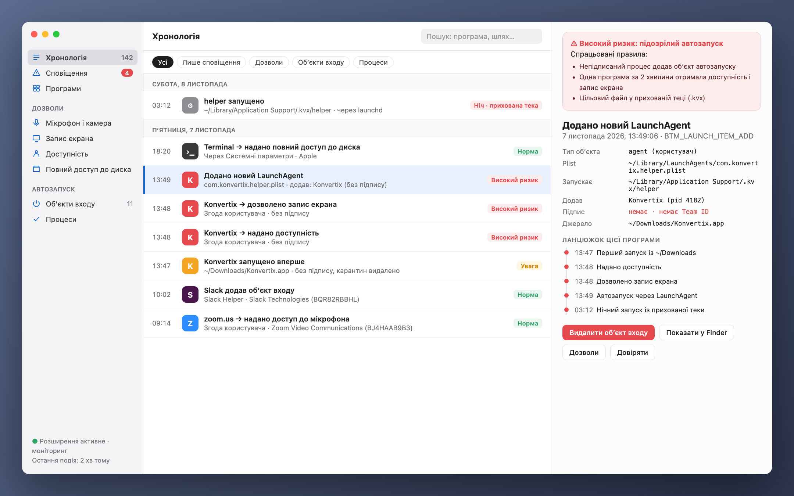
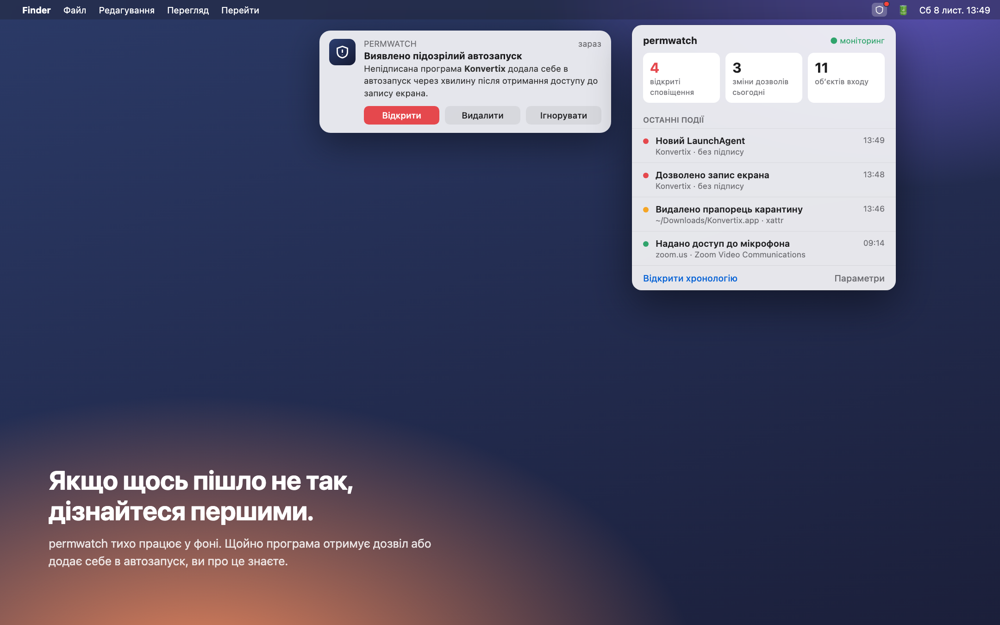
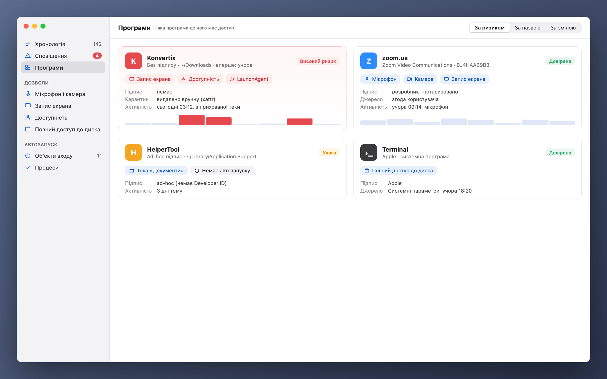

[Türkçe](README_tr.md) · [English](../../README.md) · [Русский](README_ru.md) · [Deutsch](README_de.md) · [Français](README_fr.md) · [Español](README_es.md) · [Português](README_pt.md) · [Italiano](README_it.md) · **Українська** · [日本語](README_ja.md) · [简体中文](README_zh.md) · [한국어](README_ko.md) · [العربية](README_ar.md)

# permwatch

**Дізнайтеся, до чого має доступ кожна програма на вашому Mac.**

Камера, мікрофон, запис екрана, об’єкти автозапуску. 
permwatch веде журнал усіх змін дозволів і одразу попереджає про підозрілі.

---

## Дозволили й забули

«Дозволити запис екрана». «Потрібен доступ до функцій доступності». «Відкривати під час входу?»

Ми натискаємо «OK» десятки разів на день. Але якій програмі й коли ви надали який дозвіл?
Яка з них тихо додала себе в автозапуск? macOS не показує відповідей на ці питання.

**permwatch показує.**

  

## Сценарій

Ви завантажуєте безкоштовний конвертер PDF. Відкриваєте його, він просить кілька дозволів, ви натискаєте «OK».
Усе виглядає як зазвичай.

А permwatch тим часом бачить у фоні таке:

| Час | Що сталося |
|---|---|
| 13:46 | У завантаженої програми **видалено прапорець карантину**, тобто Gatekeeper обійдено |
| 13:47 | **Непідписану** програму вперше запущено з «Завантажень» |
| 13:48 | За хвилину вона отримала і **доступність**, і **запис екрана** |
| 13:49 | Вона **додала в автозапуск програму з прихованої теки** |
| 03:12 | Уночі, поки ви спали, **ця прихована програма запустилася** |

Окремо кожен крок виглядає нешкідливо. Разом вони складаються у знайомий ланцюжок атаки.
permwatch пов’язує їх і показує одне зрозуміле сповіщення.

  

## Можливості

- 🛡 **Огляд і перевірка в один клік:** чіткий вердикт під час запуску. «Перевірити Mac» запускає пошук шкідливого ПЗ і перевіряє захоплення браузера, перехоплення трафіку (кореневі сертифікати, профілі, проксі, DNS, VPN), витоки VPN, віддалений доступ і шпигунські поєднання дозволів. Кожна знахідка має кнопку виправлення.
- 🐞 **Пошук шкідливого ПЗ:** програми, автозапуск, запущені програми й завантаження перевіряються **власними сигнатурами Apple XProtect** через відкритий рушій YARA. Швидка перевірка триває близько 10 секунд, нові завантаження перевіряються автоматично.
- 🔐 **Дозволи:** історія змін, залишкові дозволи видалених програм, відкликання в один клік, видалення програм.
- 🌐 **Мережа:** які програми куди підключаються, захоплення пакетів з іменами процесів і зрозумілими поясненнями, блокування сервера вбудованим брандмауером macOS.
- ⬇️ **Завантаження, 🎙 мікрофон і камера, ⌨️ термінал** з готовими командами безпеки.

  

## Чим permwatch не є

permwatch — **не повноцінний антивірус.** Він знаходить шкідливе ПЗ, відоме сигнатурам Apple, але не блокує програми в реальному часі. Правила евристичні: можливі хибні спрацьовування й пропуски.

## Ваша приватність лишається з вами

permwatch **нічого про вас не надсилає.** Немає аналітики, акаунта й хмари. Докладно: **[PRIVACY.md](../../PRIVACY.md)**

## Як це працює

- Читає базу дозволів macOS та об'єкти автозапуску (з повним доступом до диска) і стежить за змінами.
- Необов'язковий **режим адміністратора** встановлюється як системна служба (SMAppService) після одного підтвердження; підпис перевіряє macOS.
- Захоплення пакетів використовує libpcap та Apple PKTAP (процес для кожного пакета).
- Ядро Endpoint Security (C) для подій у реальному часі готове й чекає дозволу Apple.

## Сторонній код

- [YARA](https://github.com/VirusTotal/yara) v4.5.8 (BSD-3-Clause)
- [SwiftTerm](https://github.com/migueldeicaza/SwiftTerm) v1.20.0 (MIT)

## Статус

- ✅ Програма для macOS 13 мовами, нотаризована Apple.
- ⏳ Дозвіл Apple Endpoint Security: на розгляді.

Ви розробник і хочете спробувати ядро? **[Посібник для розробників (англійською) →](../GELISTIRME_en.md)**

---

Створено людиною, якій цікава безпека macOS, для таких самих допитливих.

