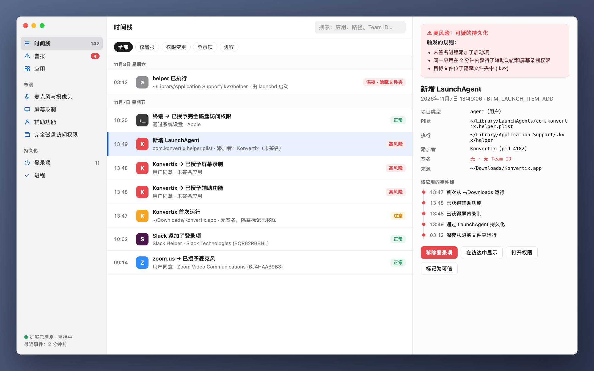
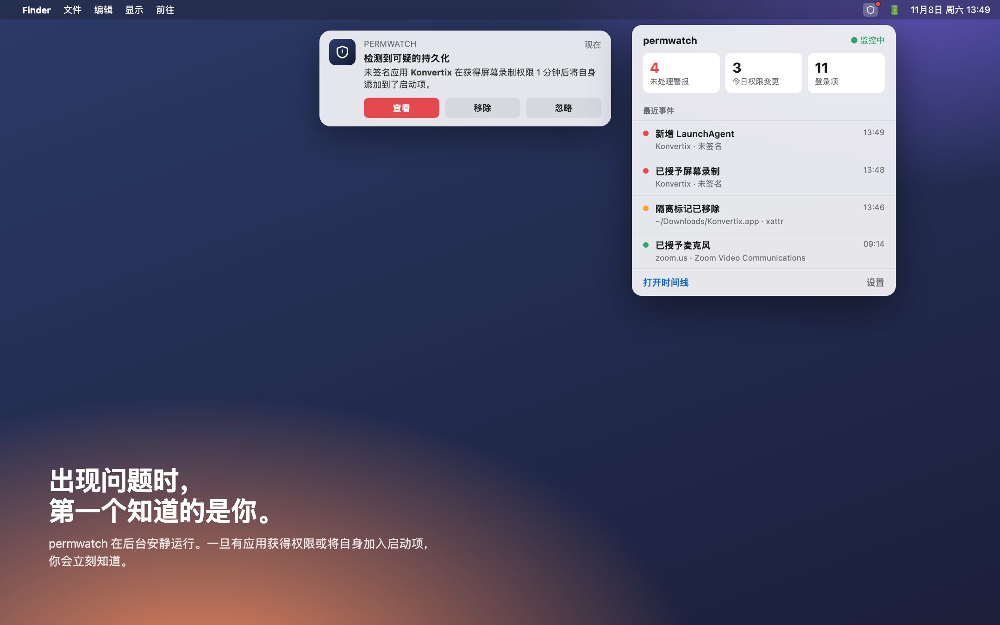
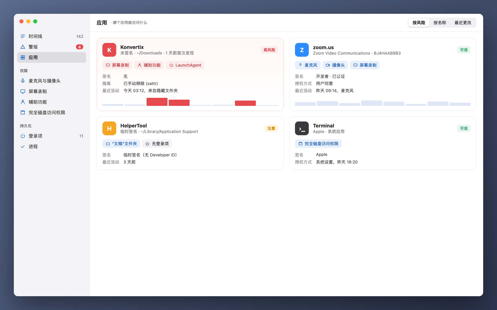

[Türkçe](README_tr.md) · [English](../../README.md) · [Русский](README_ru.md) · [Deutsch](README_de.md) · [Français](README_fr.md) · [Español](README_es.md) · [Português](README_pt.md) · [Italiano](README_it.md) · [Українська](README_uk.md) · [日本語](README_ja.md) · **简体中文** · [한국어](README_ko.md) · [العربية](README_ar.md)

# permwatch

**看清 Mac 上每个应用都能访问什么。**

摄像头、麦克风、屏幕录制、登录项。 
permwatch 记录每一次权限变更，一旦发现可疑情况立即提醒你。

---

## 点了"允许"，然后就忘了

"允许屏幕录制。""需要辅助功能权限。""登录时打开？"

我们每天要点几十次"好"。可你还记得哪个应用在什么时候获得了什么权限吗？
又是哪个应用悄悄把自己加进了启动项？macOS 不会告诉你答案。

**permwatch 会。**

  

## 一个场景

你下载了一个免费的 PDF 转换工具。打开后它请求了几项权限，你点了"好"。
一切看起来都很正常。

与此同时，permwatch 在后台看到了这些：

| 时间 | 发生了什么 |
|---|---|
| 13:46 | 下载的应用的**隔离标记被移除**，绕过了 Gatekeeper |
| 13:47 | 一个**未签名**的应用首次从"下载"文件夹运行 |
| 13:48 | 一分钟内同时获得了**辅助功能**和**屏幕录制**权限 |
| 13:49 | 它**把隐藏文件夹中的程序加入了启动项** |
| 03:12 | 深夜你熟睡时，**那个隐藏程序运行了** |

单独看，每一步都显得无害。放在一起，就是一条熟悉的攻击链。
permwatch 会把这些线索串联起来，只给你一条清晰的警报。

  

## 功能

- 🛡 **概览与一键检查:** 打开即给出明确结论。“检查我的 Mac”会运行恶意软件扫描,并检查浏览器劫持、流量拦截(根证书、描述文件、代理、DNS、VPN)、VPN 泄漏、远程访问以及间谍软件常见的权限组合。每项发现都有修复按钮。
- 🐞 **恶意软件扫描:** 使用开源 YARA 引擎,以 **Apple 自己的 XProtect 签名** 检查应用、登录项、正在运行的程序和下载内容。快速扫描约 10 秒;新下载的文件会自动扫描。
- 🔐 **权限:** 每次变更的历史、已删除应用残留的权限、一键撤销、卸载应用。
- 🌐 **网络:** 哪个应用连接到哪里、带进程名称和通俗解释的数据包捕获、用 macOS 内置防火墙阻止服务器。
- ⬇️ **下载、🎙 麦克风和摄像头、⌨️ 终端**(附带现成的安全命令)。

  

## 它不是什么

permwatch **不是完整的杀毒软件。** 它能发现 Apple 签名已知的恶意软件,但不会实时阻止程序。规则是启发式的:可能出现误报和漏报。

## 你的隐私留在你手中

permwatch **不会发送任何关于你的信息。** 没有分析、没有账户、没有云端。详情:**[PRIVACY.md](../../PRIVACY.md)**

## 工作原理

- 读取 macOS 权限数据库和登录项(需完全磁盘访问权限)并监视变化。
- 可选的 **管理员模式** 只需批准一次即作为系统服务(SMAppService)安装;签名由 macOS 验证。
- 数据包捕获使用 libpcap 和 Apple 的 PKTAP(每个数据包对应进程)。
- 用于实时事件的 Endpoint Security 引擎(C)已就绪,等待 Apple 授权。

## 第三方代码

- [YARA](https://github.com/VirusTotal/yara) v4.5.8 (BSD-3-Clause)
- [SwiftTerm](https://github.com/migueldeicaza/SwiftTerm) v1.20.0 (MIT)

## 状态

- ✅ 支持 13 种语言的 macOS 应用,已通过 Apple 公证。
- ⏳ Apple Endpoint Security 授权:审核中。

如果你是开发者，想试用核心引擎：**[开发者指南（英文）→](../GELISTIRME_en.md)**

---

由一位对 macOS 安全充满好奇的人，为同样好奇的你打造。

